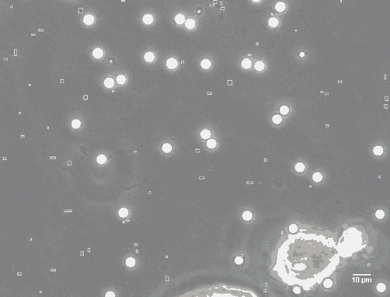
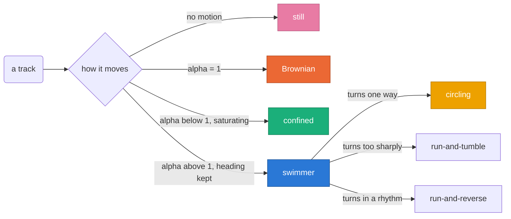
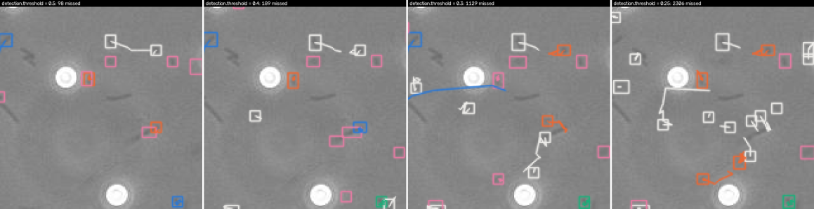
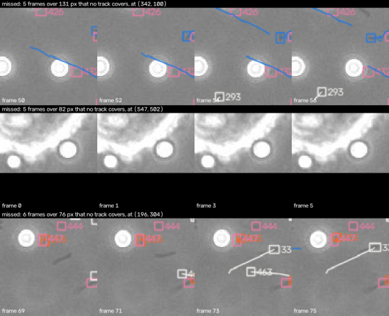
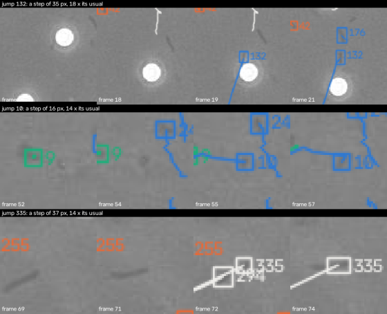
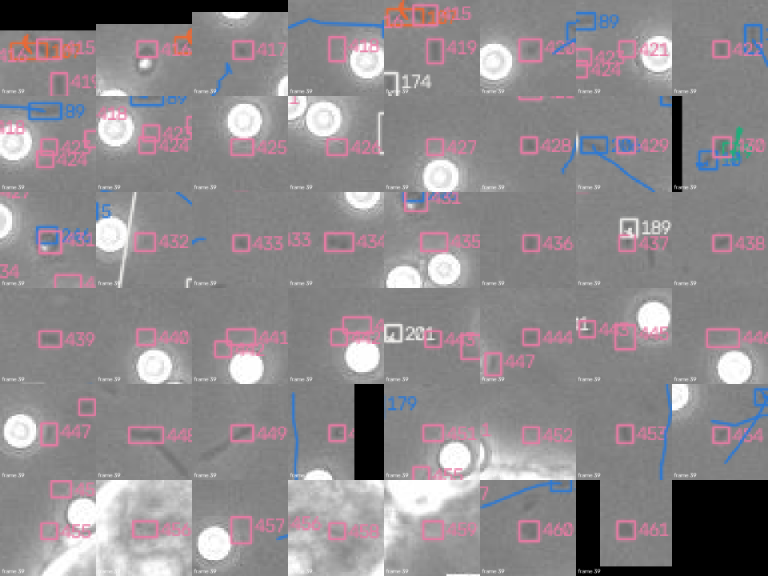

# Microorganism Computer Vision 🧫

[](https://opensource.org/licenses/Apache-2.0)
[](https://www.python.org/)
[](https://github.com/casey/just)
[](https://github.com/astral-sh/uv)
[](.agents/kanon.md)

> [!WARNING]
> **A student project of February 2025, being turned into an agent's
> toolkit.** The 2025 version was tuned by hand on one study's videos. Since
> November 2026 Claude reworks it: the tools, the statistics and the
> calibration of every video are the agent's work in progress, measured where
> a truth exists and reviewed by eye where none does. Read the results as
> work in progress, not as a published method.

**Statistical tests of how microorganisms move, read from raw microscope
video.** Each cell is tracked, then its trajectory is tested against
hypotheses of behaviour: does it diffuse, swim, tumble, circle, turn one way,
stay caged? An agent calibrates the filters and the tracker on your videos,
reviews what they miss, and reports what the cells do, in µm/s.

<div align="center">
  
  <br>
  <em>Salmonella Typhimurium near a surface, the study's video. Left: as
  filmed. Right: blue swimmers, orange diffusing, pink still cells, light
  tracks too short to judge. Calibrated by Claude.</em>
</div>

**More videos**: [the study's nine videos](docs/study/README.md), each with
its film, tracks and tests; [six synthetic scenes](docs/scenes/README.md),
each scored against its truth.

## [The model](ideas/model/README.md)

A cell is a hidden state that the video shows through noise, gaps and
swapped identities ([one trajectory](ideas/model/trajectory.md)). Before any
test, the model says what a cell can be and do:

| | |
| --- | --- |
| [](ideas/model/representation.md) | **[Representation](ideas/model/representation.md)**: a body in 3D, its view in 2D, kept as a point, an oriented point or a skeleton; the filament for rods and worms. |
| [](ideas/model/models.md) | **[Basic models](ideas/model/models.md)**: nested laws of motion, Brownian to body-frame Brownian, swimmers, run-and-tumble, anomalous walks, each with its MSD signature. |
| [](ideas/model/interactions.md) | **[Basic interactions](ideas/model/interactions.md)**: laws that depend on neighbours and decor, a weight by distance: alignment, gathering, chasing, edges that trap, gradients that attract. |
| [](ideas/model/internal-state.md) | **[Internal state](ideas/model/internal-state.md)**: a hidden state that switches, or a slow vector whose normalised weights mix basic laws. |

## [The hypotheses, tested](ideas/model/hypotheses/README.md)

The 2025 project tested six hypotheses with fixed thresholds. They are now
statistical tests, each with a null model, a p-value, and a correction for
testing hundreds of tracks at once (Benjamini-Hochberg).



The colours are the verdicts' in every video and figure. Left out of the
drawing: the test of non-Gaussian steps, run on every track, which flags
heavy tails such as waiting times and Lévy flights.

**Every test is checked on a truth.** Synthetic cells of ten behaviours, a
hundred tracks each, with localisation noise; the share of tracks each test
calls significant (q < 0.05). On a behaviour that satisfies the null this is
the false positive rate, near 0.05 at most; elsewhere it is the power.

| True behaviour | [anomalous](ideas/model/hypotheses/one-cell/anomalous.md) | [persistent](ideas/model/hypotheses/one-cell/persistent.md) | [chiral](ideas/model/hypotheses/one-cell/chiral.md) | [heavy tails](ideas/model/hypotheses/one-cell/heavy-tails.md) | [tumbling](ideas/model/hypotheses/one-cell/tumbling.md) | [rhythmic](ideas/model/hypotheses/one-cell/rhythmic.md) | [confined](ideas/model/hypotheses/one-cell/confined.md) |
| --- | ---: | ---: | ---: | ---: | ---: | ---: | ---: |
| Brownian | **0.01** | **0.00** | **0.00** | **0.00** | **0.00** | **0.00** | **0.02** |
| Swimmer | 1.00 | 1.00 | 0.00 | 0.25 | 0.00 | 0.00 | 0.00 |
| Run-and-tumble | 1.00 | 1.00 | 0.00 | 0.97 | **0.91** | 0.00 | 0.00 |
| Run-and-reverse | 1.00 | 0.00 | 0.00 | 1.00 | 0.00 | **1.00** | 0.00 |
| Circling | 1.00 | 1.00 | **1.00** | 0.99 | 0.00 | 0.00 | 0.00 |
| Confined | 0.88 | 0.00 | 0.00 | 0.00 | 0.00 | 0.00 | **0.77** |
| CTRW, heavy waits | 0.05 | 0.00 | 0.00 | **0.95** | 0.00 | 0.00 | 0.03 |
| Lévy walk | 1.00 | 0.99 | 0.00 | 0.97 | 0.91 | 0.00 | 0.00 |

What fails, said plainly: fractional subdiffusion ($\alpha = 0.6$) over 100
frames goes undetected, its bend smaller than the noise's. The rhythm test
failed too, until two causes were found: the 2025 spectrum of signed angles
hides reversals, whose sign is random, and the synthetic reversals had no
rhythm ([rhythmic](ideas/model/hypotheses/one-cell/rhythmic.md)).

## [The agent's tools](docs/tools.md)

A pipeline gets most cells right and some wrong. The agent finds which, by
eye, and corrects them; every correction is an annotation, with its reason.

| | |
| --- | --- |
|  | **[`mcv sweep`](docs/tools.md#sweep)**: one parameter over several values, the same view side by side. Here no threshold catches the large diagonal rods: the 2025 area filter measured bounding boxes, which grow when a rod lies diagonally. |
|  | **[`mcv misses`](docs/tools.md#misses)**: a looser detection, tracked, where no kept track goes. The agent looks; plain rods get `mcv correct ... force`. |
|  | **[`mcv suspects`](docs/tools.md#suspects)**: jumps that look like identity swaps, broken tracks, unsure verdicts, filmed up close; `mcv correct ... split / join / drop / label`. |
|  | **[`mcv gallery`](docs/tools.md#gallery)**: every track of one verdict at once. These are still rods, dead or sleeping, which a median background erased from every frame until the agent noticed. |

Also: [`mcv probe`](docs/tools.md#probe) measures a video and reads its scale
bar, [`mcv inspect`](docs/tools.md#inspect) films one track,
[`mcv stats`](docs/tools.md#stats) compares populations,
[`mcv synth`](docs/tools.md#synth) renders a twin with a known truth,
[`mcv bench`](docs/tools.md#bench) and [`mcv search`](docs/tools.md#search)
score against it.

## Read more

- [The study's videos, case by case](docs/cases/salmonella.md): Salmonella
  near surfaces and host cells, in µm/s.
- [The calibration, measured](docs/benchmark/calibration.md): the agent
  against blind and local searches on unseen scenes.
- [The method an agent follows](docs/guide.md), printed by `mcv guide`.
- [Twenty sources of motility videos](catalogue/sources.yaml), their truth
  and licence.

## Use it

```bash
just install                 # Python 3.14 and the locked dependencies, by uv
just extract                 # the nine videos of the 2025 study, into data/
uv run mcv guide             # the method, for you or your agent
uv run mcv probe data/342843.avi
```

## Where it comes from

A student project of February 2025
([its README](https://github.com/Ophiase/Microorganism-Computer-Vision/tree/v0.5)),
its six hypothesis tests the seed of this one. The plan is in
[ideas/](ideas/README.md); the rules any contributor follows, human or agent,
in [AGENTS.md](AGENTS.md). The canon is [.agents/kanon.md](.agents/kanon.md);
`<>` is its sign.
