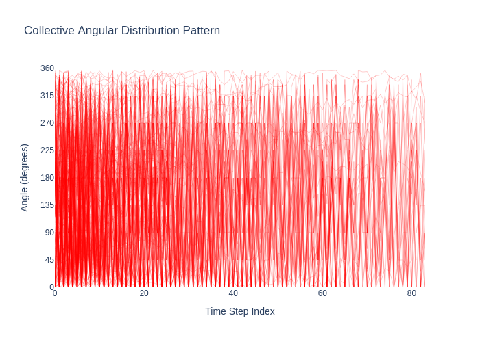
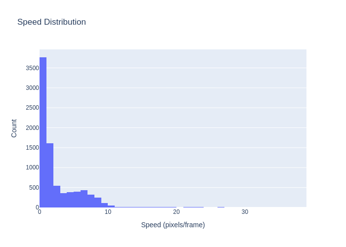

# Microorganism Computer Vision 🧫

[](https://opensource.org/licenses/Apache-2.0)
[](https://www.python.org/)
[](https://github.com/casey/just)
[](https://github.com/astral-sh/uv)
[](.agents/kanon.md)

A comprehensive computer vision pipeline for analyzing microorganism 🦠
motility patterns and diffusion characteristics.

Deadline: 28th February 2025

<div align="center">
  
  
  
</div>

## 🌟 Features

- **Multi-modal Tracking**
  - Optical flow-based motion estimation
  - Kalman-filter enhanced object detection
  - Synthetic trajectory generation
- **Advanced Diffusion Analysis**
  - 6 statistical hypothesis tests for motility patterns
  - Automated trajectory classification
  - Comprehensive visualization toolkit
- **Scalable Architecture**
  - Modular pipeline design
  - Configurable hypothesis parameters
  - Batch processing capabilities

## 🧩 Diffusion Hypothesis Tests

Our framework implements statistical tests to characterize microbial motion:

| Hypothesis Test | Key Mechanism | Biological Relevance |
|-----------------|---------------|----------------------|
| **Circular Motion** <br> `CircularMotionTest` | Curvature analysis + rotation angle detection | Magnetotactic bacteria, spiral-seeking organisms |
| **Directional Switching** <br> `DirectionalSwitchTest` | Fourier analysis of angular changes | Run-and-tumble motility (e.g., *E. coli*) |
| **Gaussian Random Walk** <br> `GaussianRandomWalkTest` | Kolmogorov-Smirnov normality test | Passive diffusion in isotropic environments |
| **MSD Linear Fit** <br> `MSDLinearTest` | R² evaluation of mean squared displacement | Normal diffusion processes |
| **Persistent Motion** <br> `PersistentMotionTest` | Velocity autocorrelation analysis | Active transport mechanisms |
| **Subdiffusion** <br> `SubDiffusionTest` | Power law exponent ($\alpha < 1$) detection | Crowded environments, viscoelastic media |

## 🚀 Installation

```bash
# Clone repository
git clone git@github.com:Ophiase/Microorganism-Computer-Vision.git
cd Microorganism-Computer-Vision

# Install the environment: Python 3.14 and the dependencies of uv.lock
just install

# Download the nine source videos into data/, which stays out of git
just extract
```

Python runs through `uv`, never through a hand-made virtualenv: `just` wraps
every command, and `just --list` shows them all.

## 🧪 Usage

Process real videos:

```bash
# Full pipeline execution
just run transform      # Preprocess videos
just run detection      # Track microorganisms
just run render         # Generate gifs
just run analysis       # Run statistical tests and graphics
```

Generate synthetic data:

```bash
just run synthetic      # Create trajectory datasets
just run analysis --video synthetic_brownian
# "brownian" can be replaced by directed, sinusoidal, confined, ctrw, ...
```

The recipes:

```bash
just run <task>     # transform, detection, render, analysis, synthetic
just test           # The unit tests
just check          # Lint, types and tests
just agent gate     # What must pass before declaring work done
```

The analysis keeps every trajectory by default; `--keep moving` or
`--keep fastest` drops the dust that never moved, which otherwise drowns the
distributions. `--debug` opens the figures as they are computed.

## 📊 Results Interpretation

- <div style="text-align: center;">
  
  

</div>

- <div style="text-align: center;">
  
  

</div>

## 📂 Data Structure

```bash
microorganism-cv/
├── data/                           # Raw and processed data, out of git
│   ├── preprocessed/               # The channel tensors of a video
│   └── tracking/                   # One file of boxes per frame
├── logic/                          # Core algorithms
│   ├── diffusion/                  # The six hypothesis tests and the MSD
│   ├── structure/                  # Rectangle and BoundingBox
│   ├── filters.py                  # Trend, detail and gradient channels
│   ├── kalman_filter.py            # The tracker
│   └── trajectories.py             # A track through time
├── script/                         # One file per pipeline task
├── synthetic/                      # The trajectory generator and its datasets
├── tests/                          # The unit tests
└── visualization/                   # The figures, split by concept
```

## 📚 Methodology

Our pipeline implements a multi-stage analysis process:

### Preprocessing

- Optical flow estimation
- Spatial normalization
- Noise reduction

### Object Detection

- Adaptive thresholding (❌ not implemented)
- Connected component analysis
- Kalman-filter based tracking

### Trajectory Analysis

- [MSD](https://en.wikipedia.org/wiki/Mean_squared_displacement) calculations
- Velocity autocorrelation
- Directional persistence metrics

### Statistical Classification

- Hypothesis testing
- Confidence interval estimation (❌ not implemented)
- [Motility](https://en.wikipedia.org/wiki/Motility) pattern classification

## ✍️ Working on it

The toolchain is `just` and `uv` on Python 3.14: `just install` creates the
environment, `just check` runs the lint, the types and the tests, and
`just agent gate` adds the file checks. What a contributor may write — file
size, comments, types, tests — is in [AGENTS.md](AGENTS.md); the rules
themselves are in [.agents/portable/](.agents/portable/).

The canon is [.agents/kanon.md](.agents/kanon.md); `<>` is its sign.
