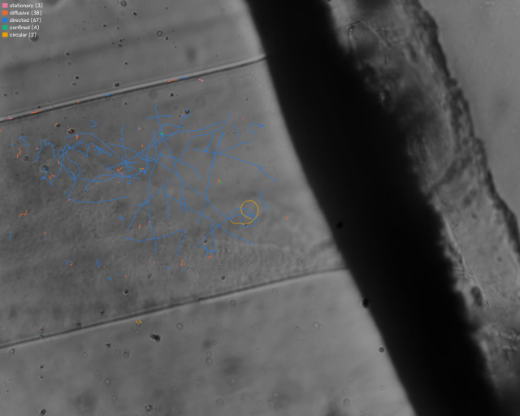
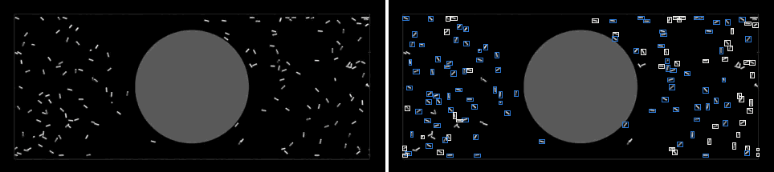
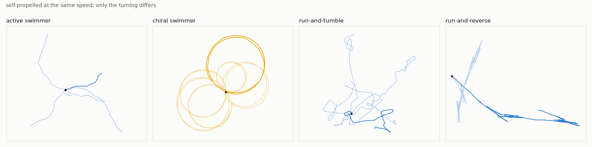
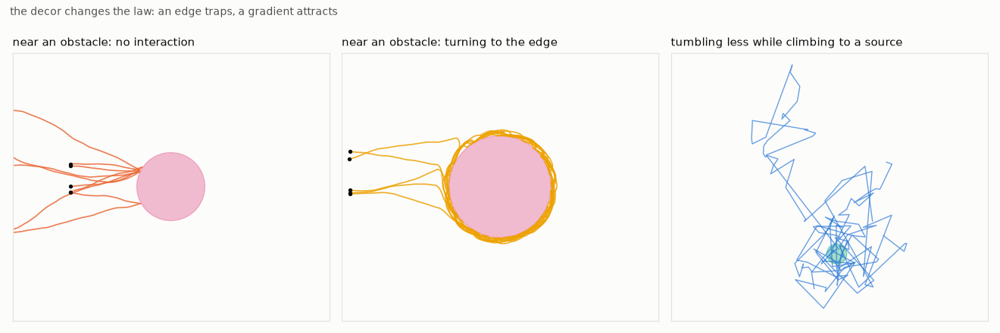
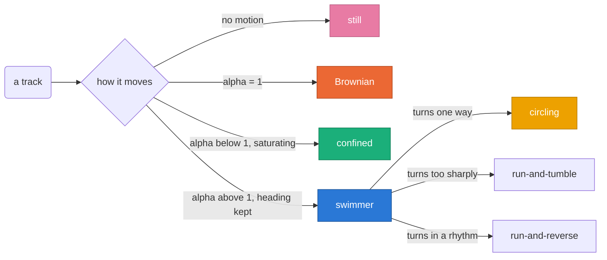
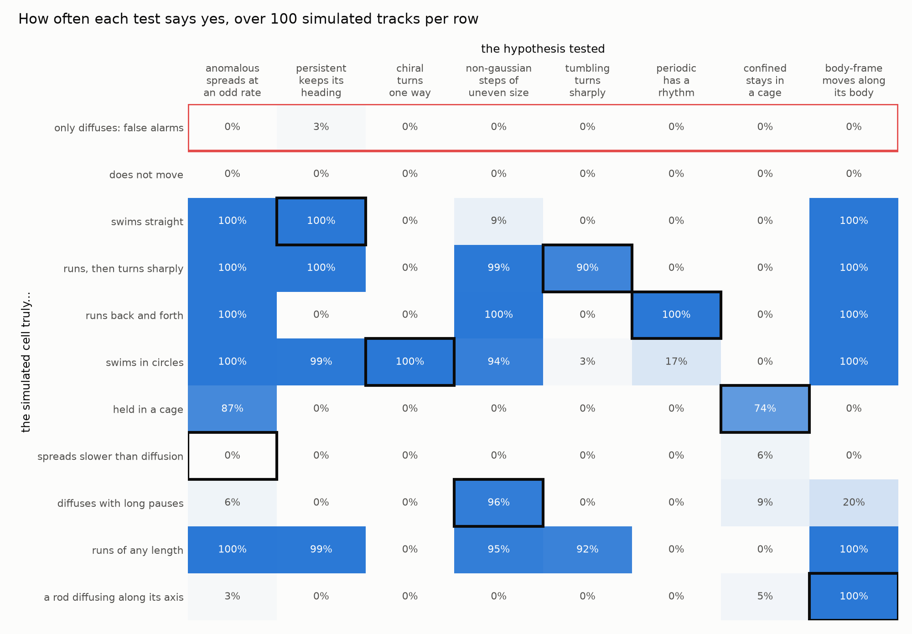

# Microorganism Computer Vision 🧫

[](https://opensource.org/licenses/Apache-2.0)
[](https://www.python.org/)
[](https://github.com/casey/just)
[](https://github.com/astral-sh/uv)
[](.agents/kanon.md)

> [!WARNING]
> **Work in progress, by an agent.** The tools, the statistics and the
> calibration of every video are Claude's work since November 2026, measured
> where a truth exists and reviewed by eye where none does. Read the results
> as work in progress, not as a published method. It began as a student
> project ([where it comes from](#where-it-comes-from)).

> [!NOTE]
> **Why it is built this way**: [the metaphilosophy](ideas/metaphilosophy.md).
> Some of what makes research work is not in a model's weights; an agent can
> craft it for itself as small explicit tools, and the author's part is to
> watch for the patterns that hold it back.

**Statistical tests of how microorganisms move, read from raw microscope
video.** Each cell is tracked, then its trajectory is tested against
hypotheses of behaviour: does it diffuse, swim, tumble, circle, turn one way,
stay caged? An agent calibrates the filters and the tracker on your videos,
reviews what they miss, and reports what the cells do, in µm/s.

Three kinds of video it has read, each calibrated by Claude:

| [Salmonella near a surface](docs/cases/salmonella.md) | [Pseudomonas under antibiotics](docs/cases/antibiotics.md) | [Simulated run-and-tumble](docs/cases/simulated-tumbling.md) |
| :---: | :---: | :---: |
|  |  |  |
| The 2025 study's video: swimmers in blue, diffusing cells in orange | A low-cost microscope: under every drug, swimmers are slower | Known run times: the tumbles found follow them |

**More videos**: [the study's nine videos](docs/study/README.md), each with
its film, tracks and tests; [six synthetic scenes](docs/scenes/README.md),
each scored against its truth; the sources still to read are in
[the catalogue](catalogue/sources.yaml).

## [The model](ideas/model/README.md)

A cell is a hidden state that the video shows through noise, gaps and
swapped identities ([one trajectory](ideas/model/trajectory.md)). Before any
test, the model says what a cell can be and do:

| | |
| --- | --- |
| [](ideas/model/representation.md) | **[Representation](ideas/model/representation.md)**: a body in 3D, its view in 2D, kept as a point, an oriented point or a skeleton; the filament for rods and worms. |
| [](ideas/model/models.md) | **[Basic models](ideas/model/models.md)**: nested laws of motion, Brownian to body-frame Brownian, swimmers, run-and-tumble, anomalous walks, each with its MSD signature. |
| [](ideas/model/interactions.md) | **[Basic interactions](ideas/model/interactions.md)**: laws that depend on neighbours and decor, a weight by distance: alignment, gathering, chasing, edges that trap, gradients that attract. |
| [](ideas/model/internal-state.md) | **[Internal state](ideas/model/internal-state.md)**: a hidden state that switches, or a slow vector whose normalised weights mix basic laws. |

## [The hypotheses, tested](ideas/model/hypotheses/README.md)

A hypothesis asks one question of the tracks, at one of three scales:

| Scale | Asks | Built |
| --- | --- | --- |
| [One cell](ideas/model/hypotheses/one-cell/README.md) | does it swim, turn sharply, circle one way, stay caged? | eight tests, `mcv run` |
| [A population](ideas/model/population.md) | how many swim, and does the whole population turn one way? | shares and a chirality bias, `mcv stats` |
| [The decor and the others](ideas/model/hypotheses/context.md) | are cells held or slowed near objects; do neighbours align? | held and slowed, `mcv interactions` |

Each is a statistical test: a null model the cell would follow without the
behaviour, a p-value, and a correction for testing hundreds of tracks at once.
The tree below is the scale of one cell.



The colours are the verdicts' in every video and figure. Left out of the
drawing: the test of non-Gaussian steps, run on every track, which flags
heavy tails such as waiting times and Lévy flights.

**Every test is checked on a truth.** Synthetic cells whose behaviour is
known, a hundred tracks each, with noise on every position. Blue means the test
says yes.



- **The red row should stay white**: a cell that only diffuses, so every yes
  there is a false alarm. At most 3 %.
- **A boxed cell should be blue**: the test made for that behaviour finds it,
  74 to 100 % of the time, except one.
- **The other blue cells are right too**: a swimmer is also *anomalous*, it
  spreads faster than diffusion.

The maths of each test is on its own page:
[the hypotheses](ideas/model/hypotheses/README.md);
`mcv validate` redraws this figure.

**The one that fails**, the white boxed cell: fractional subdiffusion
($\alpha = 0.6$) over 100
frames goes undetected, its bend smaller than the noise's. The rhythm test
failed too, until two causes were found: the 2025 spectrum of signed angles
hides reversals, whose sign is random, and the synthetic reversals had no
rhythm ([rhythmic](ideas/model/hypotheses/one-cell/rhythmic.md)).

## What the tools found

On the study's video, every cell's long axis measured from its shape
([body-frame](ideas/model/hypotheses/one-cell/body-frame.md)):

- **Swimmers move eleven times more along their axis than across it**: they
  swim along their bodies, and the axis measured on rods of a few pixels is
  sound.
- **Non-motile rods diffuse 2.7 times more along their axis**: Brownian kicks
  in the body's frame, near what a slender passive rod should show.

## [The agent's tools](docs/tools.md)

A pipeline gets most cells right and some wrong. The agent finds which, by
eye, and corrects them; every correction is an annotation, with its reason.

| | |
| --- | --- |
|  | **[`mcv sweep`](docs/tools.md#sweep)**: one parameter over several values, the same view side by side. Here no threshold catches the large diagonal rods: the 2025 area filter measured bounding boxes, which grow when a rod lies diagonally. |
|  | **[`mcv misses`](docs/tools.md#misses)**: a looser detection, tracked, where no kept track goes. The agent looks; plain rods get `mcv correct ... force`. |
|  | **[`mcv suspects`](docs/tools.md#suspects)**: jumps that look like identity swaps, broken tracks, unsure verdicts, filmed up close; `mcv correct ... split / join / drop / label`. |
|  | **[`mcv gallery`](docs/tools.md#gallery)**: every track of one verdict at once. These are still rods, dead or sleeping, which a median background erased from every frame until the agent noticed. |

Also: [`mcv probe`](docs/tools.md#probe) measures a video and reads its scale
bar, [`mcv inspect`](docs/tools.md#inspect) films one track,
[`mcv stats`](docs/tools.md#stats) compares populations,
[`mcv synth`](docs/tools.md#synth) renders a twin with a known truth,
[`mcv bench`](docs/tools.md#bench) and [`mcv search`](docs/tools.md#search)
score against it.

## Read more

- [The study's videos, case by case](docs/cases/salmonella.md): Salmonella
  near surfaces and host cells, in µm/s.
- [Motility under antibiotics](docs/cases/antibiotics.md): Pseudomonas
  aeruginosa at several doses, filmed with a 3D-printed microscope.
- [Simulated run-and-tumble](docs/cases/simulated-tumbling.md): swimmers of
  known run time, rendered by another engine.
- [The calibration, measured](docs/benchmark/calibration.md): the agent
  against blind and local searches on unseen scenes.
- [The method an agent follows](docs/guide.md), printed by `mcv guide`.
- [Twenty sources of motility videos](catalogue/sources.yaml), their truth
  and licence.

## Use it

```bash
just install                 # Python 3.14 and the locked dependencies, by uv
uv run mcv guide             # the method, for you or your agent
uv run mcv probe your-video.avi
uv run mcv sources           # videos found elsewhere, with their licence
uv run mcv fetch NAME        # bring one of them into data/
```

Any video, TIFF stack or folder of frames works. To find more:
[where to look](catalogue/README.md), the repositories and journals
that hold motility videos and how to search them; [what was found](catalogue/sources.yaml),
each source with its truth, licence and trust.

## Contributors

- **Phorcys** ([Ophiase](https://github.com/Ophiase)): author.
- **Anthos**: the agent, Claude in Claude Code. In Greek, *anthos* is the
  flower: a gifted disciple whose intelligence is channelled so that flowers
  grow.

See [CONTRIBUTORS.md](CONTRIBUTORS.md).

## Where it comes from

A student project of February 2025
([its README](https://github.com/Ophiase/Microorganism-Computer-Vision/tree/v0.5)),
its six hypothesis tests the seed of this one. The plan is in
[ideas/](ideas/README.md); the rules any contributor follows, human or agent,
in [AGENTS.md](AGENTS.md). The canon is [.agents/kanon.md](.agents/kanon.md);
`<>` is its sign.
