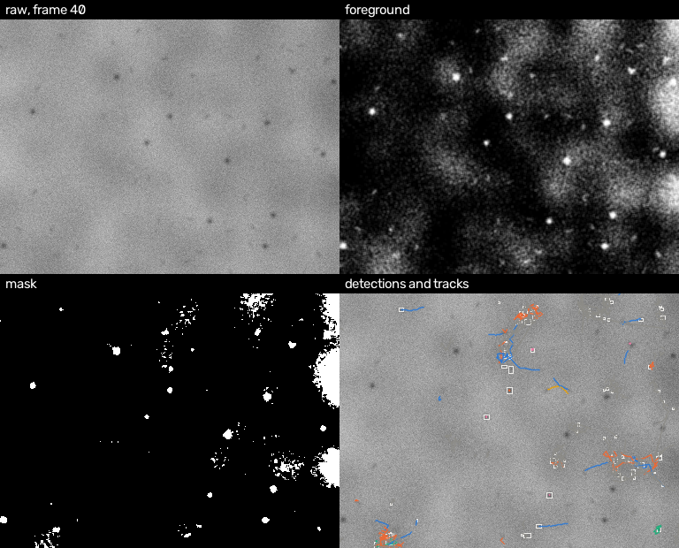
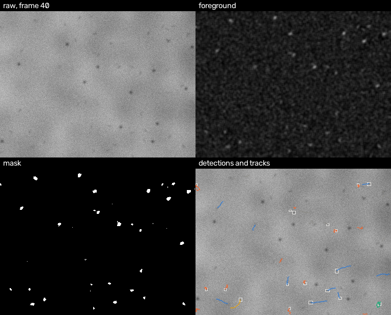
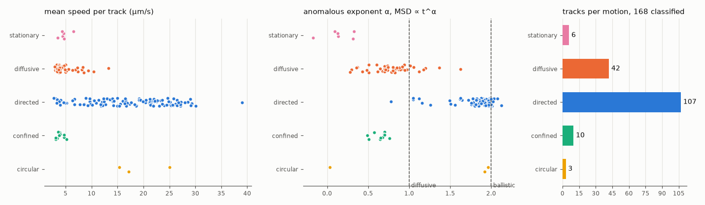

# Microorganism Computer Vision 🧫

[](https://opensource.org/licenses/Apache-2.0)
[](https://www.python.org/)
[](https://github.com/casey/just)
[](https://github.com/astral-sh/uv)
[](.agents/kanon.md)

**You have videos of swimming cells. An agent tunes a classical pipeline on
them, checks itself against a synthetic twin with a known truth, and tells you
how your cells move, in micrometres per second, with the reason for every
setting.** No labels, no training, no GPU: filters, a Kalman tracker and a
model selection that run on a laptop in seconds.

<div align="center">
  
  <br>
  <em>Salmonella from the 2025 study: swimmers in blue, diffusing cells in orange,
  the beads and host cells excluded. Calibrated by Claude.</em>
</div>

## Why an agent

Reading motility from a microscope video used to mean one of two things: a
pipeline tuned by hand by an expert for one microscope, or a network trained
on labels a researcher with one Petri dish does not have. An agent can be the
expert: it **looks** at the frames, **measures**, changes one knob and says
why, and **checks** itself on a truth before it is trusted.

This repository is the toolkit made for that agent: every parameter is
documented and bounded, every command answers in JSON, every run is a folder
of pictures the agent opens and a report a researcher reads.

## What an agent did with it

### 1. Beat a blind search, on scenes it never tuned on

Three microscope situations, each a researcher's video: dark swimmers among
dust, bright fluorescent cells, a dim crowded drop. Every method had up to ten
runs scored against the truth of a tuning video; the score is on a second
video of the same kind, unseen: the mean of the tracking (MOTA) and of the
classification accuracy.

| Scene | 2025 | Blind ×3 | Local from the probe | **Agent** (runs) |
| --- | ---: | ---: | ---: | ---: |
| Dark swimmers and dust | −0.59 | 0.52 | 0.76 | **0.80** (5) |
| Fluorescence, sparse | 0.00 | 0.81 | 0.78 | **0.86** (3) |
| Dim and crowded | 0.00 | 0.22 | −0.15 | **0.59** (8) |

Where a search finds the answer, the agent matches its best seed in fewer
runs. Where the answer is a change seen in the image, the dim drop's uneven
background, it is far ahead. The protocol, every baseline and each step of
the agent with its reason: [docs/benchmark/calibration.md](docs/benchmark/calibration.md).

| The dim drop, as the probe suggested | After the agent's five steps |
| --- | --- |
|  |  |

### 2. Read the study's own video, in physical units

The probe said the objects were bright; the motion map showed dark rods. The
agent switched the polarity, read **0.323 µm per pixel off the burnt-in scale
bar**, and found that no threshold separates the rods from the halos of the
beads: it **added a tool to the library**, the exclusion of static objects.



107 swimmers at a median of **18.3 µm/s** (α ≈ 2) and 42 diffusing cells
(α ≈ 1). On a twin of the video with a known truth: 0.84, against 0.19 for
the 2025 settings. The whole story, its limits included:
[docs/cases/salmonella.md](docs/cases/salmonella.md).

### 3. Refuse to transfer a setting blindly

Another video of the same study gave mostly "diffusive" cells. The agent
probed it before believing it: host cells, another scale, burnt-in cursors
and a hand-drawn track. Another experiment, to be calibrated on its own.

## Use it

```bash
just install                 # Python 3.14 and the locked dependencies, by uv
just extract                 # the nine videos of the 2025 study, into data/
just mcv guide               # the method, for you or your agent
```

```bash
mcv probe data/342843.avi             # measure, suggest, draw
mcv run data/342843.avi --clip :80 \
    --config output/runs/342843/probe/suggested.toml
mcv run data/342843.avi --config c.toml \
    --set detection.threshold=0.4 --reason "faint cells absent from the mask"
mcv history data/342843.avi           # the journal
mcv synth twin --like output/runs/342843/probe/appearance.json
mcv bench --scene output/synthetic/twin/scene.toml --config c.toml
mcv search --budget 10                # the blind baseline
mcv schema                            # every parameter
mcv sources                           # where to find videos
```

`mcv` is `uv run mcv` from the clone, or `just mcv`. It reads a video, a TIFF
stack or a folder of images. With Claude Code,
the skill [calibrate-motility](.claude/skills/calibrate-motility/SKILL.md)
starts the loop when you bring a video; any agent reads
[docs/guide.md](docs/guide.md).

A run writes, in `output/runs/<video>/<n>/`: four-view looks of chosen
frames (raw, foreground, mask, tracks), the trajectory map, the
distributions, `tracks.gif`, `tracks.csv`, `verdicts.csv`, `summary.json`
with hints, the configuration with its reason, and `report.md`.

## How it works

1. **Foreground**: an optional temporal-median background, the polarity, an
   intensity window, a box filter, the exclusion of large static objects.
2. **Detection**: a threshold and connected regions kept by their size.
3. **Tracking**: a constant-velocity Kalman filter per cell, matched to the
   detections by the Hungarian algorithm within a gate.
4. **Verdicts**: four laws of the mean squared displacement (stationary,
   diffusive, directed, confined) weighted by Qian's variance and compared by
   their AICc, a turning test for circling, and α with its interval.
5. **Truth**: synthetic scenes of rod-shaped cells, dust and uneven light,
   rendered with every position known; the tracks scored by MOTA, the
   verdicts by accuracy.

The sources of real videos, their truth, licence and trust are in
[catalogue/sources.yaml](catalogue/sources.yaml), twenty of them, from
sperm tracks with identities to worms on Petri plates.

## Limits

- The verdicts need tracks of 20 observations; a cell that leaves the focal
  plane quickly stays undetermined.
- The α interval comes from the regression alone; the MSD lags are
  correlated, so it is a lower bound on the uncertainty.
- The synthetic scenes are 2D and rods only: no swimming out of focus, no
  dividing or touching cells. A score on them is a check, not a proof.
- The agent's results above are one agent's runs, on three scenes; the
  baselines ran on three seeds.

## Where it comes from

A student project of February 2025: a pipeline tuned by hand in two months on
one study's videos ([the 2025 README](https://github.com/Ophiase/Microorganism-Computer-Vision/tree/v0.5)).
Rebuilt in November 2026 as an agent's toolkit: the plan and its reasons are
in [ideas/](ideas/README.md), the history in [CHANGELOG.md](CHANGELOG.md).

## Working on it

`just check` runs the lint, the types and the tests; `just agent gate` adds
the file checks and declares work done. The rules any contributor follows,
human or agent, are in [AGENTS.md](AGENTS.md). The canon is
[.agents/kanon.md](.agents/kanon.md); `<>` is its sign.
