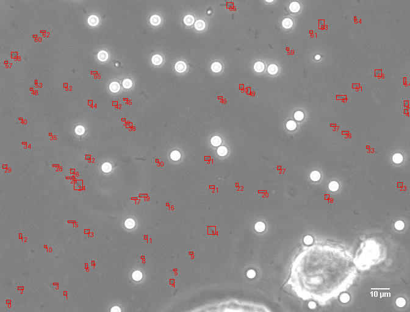
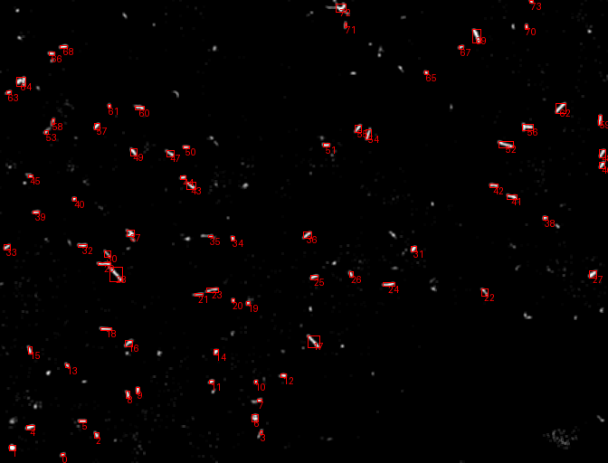
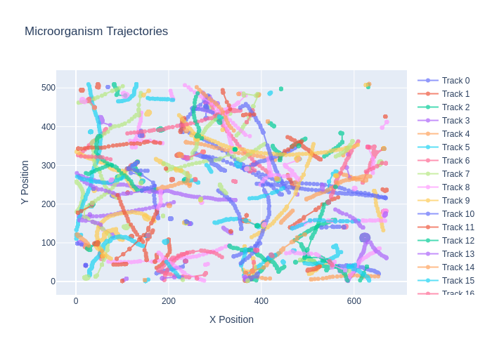
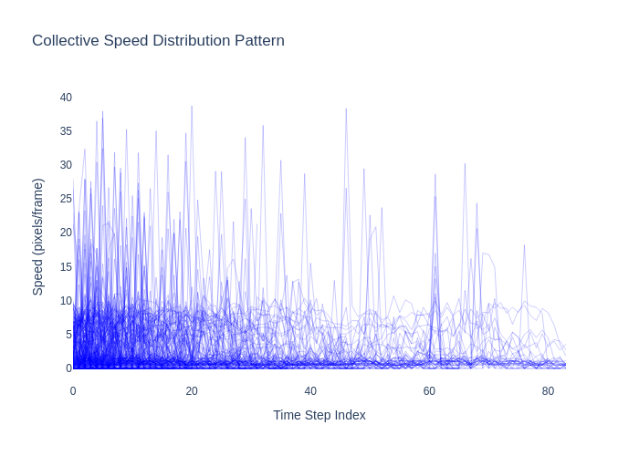

# Microorganism Computer Vision 🧫

[](https://opensource.org/licenses/Apache-2.0)
[](https://www.python.org/)
[](https://github.com/casey/just)
[](https://github.com/astral-sh/uv)
[](.agents/kanon.md)

> [!WARNING]
> **An old student project.** I wrote it as a student, for a deadline on
> 28 February 2025. Only its tooling has been brought up to date; the code and
> the method are still the student version. I will soon modernize it with my
> agents, as an experiment, in a future PR: the plan is in
> [ideas/](ideas/README.md).

A computer vision pipeline that tracks microorganisms 🦠 in video and tests
their trajectories against diffusion hypotheses.

## Direction

The student version was tuned by hand, in two months of spare time, on one
study's videos; going further would usually mean machine learning: label
data, train a network. **In a future PR, the project will take another
direction**: a toolkit of classical filters, tracking and diffusion tests that
an agent calibrates on a researcher's own videos, against typical baselines.
That work has not started yet: what follows describes the student version.
The plan is in [ideas/vision.md](ideas/vision.md); the sources of videos are
in [catalogue/sources.yaml](catalogue/sources.yaml).

<div align="center">
  
  
  
</div>

## 🌟 What it does today

- **Detection and tracking**: Farneback optical flow, a threshold and
  contours for the cells, a Kalman filter with Hungarian matching to link
  them across frames.
- **Six diffusion tests** on each trajectory, from the mean squared
  displacement, the velocity autocorrelation and the turning angles.
- **A trajectory generator**: brownian, directed, confined, CTRW and
  sinusoidal motions, with their truth.
- **Figures**: trajectories, speed and angle distributions, GIFs of the
  tracked video.

## ⚠️ Known limits

Measured in [ideas/baseline.md](ideas/baseline.md):

- The six tests are thresholds, not a classification: they overlap, and
  give no uncertainty.
- Speeds are in pixels per frame; no physical unit yet.
- The transform step is slow and memory-hungry, so a run stops at 85 frames.
- `just run analysis` needs Chrome to write its PNG figures.
- Nothing measures the tracking against a known truth yet.

## 🧩 Diffusion Hypothesis Tests

Our framework implements statistical tests to characterize microbial motion:

| Hypothesis Test | Key Mechanism | Biological Relevance |
|-----------------|---------------|----------------------|
| **Circular Motion** <br> `CircularMotionTest` | Curvature analysis + rotation angle detection | Magnetotactic bacteria, spiral-seeking organisms |
| **Directional Switching** <br> `DirectionalSwitchTest` | Fourier analysis of angular changes | Run-and-tumble motility (e.g., *E. coli*) |
| **Gaussian Random Walk** <br> `GaussianRandomWalkTest` | Kolmogorov-Smirnov normality test | Passive diffusion in isotropic environments |
| **MSD Linear Fit** <br> `MSDLinearTest` | R² evaluation of mean squared displacement | Normal diffusion processes |
| **Persistent Motion** <br> `PersistentMotionTest` | Velocity autocorrelation analysis | Active transport mechanisms |
| **Subdiffusion** <br> `SubDiffusionTest` | Power law exponent ($\alpha < 1$) detection | Crowded environments, viscoelastic media |

## 🚀 Installation

```bash
# Clone repository
git clone git@github.com:Ophiase/Microorganism-Computer-Vision.git
cd Microorganism-Computer-Vision

# Install the environment: Python 3.14 and the dependencies of uv.lock
just install

# Download the nine source videos into data/, which stays out of git
just extract
```

Python runs through `uv`, never through a hand-made virtualenv: `just` wraps
every command, and `just --list` shows them all.

## 🧪 Usage

Process real videos:

```bash
# Full pipeline execution
just run transform      # Preprocess videos
just run detection      # Track microorganisms
just run render         # Generate gifs
just run analysis       # Run statistical tests and graphics
```

Generate synthetic data:

```bash
just run synthetic      # Create trajectory datasets
just run analysis --video synthetic_brownian
# "brownian" can be replaced by directed, sinusoidal, confined, ctrw, ...
```

The recipes:

```bash
just run <task>     # transform, detection, render, analysis, synthetic
just test           # The unit tests
just check          # Lint, types and tests
just agent gate     # What must pass before declaring work done
```

The analysis keeps every trajectory by default; `--keep moving` or
`--keep fastest` drops the dust that never moved, which otherwise drowns the
distributions. `--debug` opens the figures as they are computed.

## 📊 Results Interpretation

- <div style="text-align: center;">
  
  

</div>

- <div style="text-align: center;">
  
  

</div>

## 📂 Data Structure

```bash
microorganism-cv/
├── data/                           # Raw and processed data, out of git
│   ├── preprocessed/               # The channel tensors of a video
│   └── tracking/                   # One file of boxes per frame
├── libraries/motility/            # The library: arrays in, measures out
│   └── src/motility/
│       ├── vision/                 # Filters, optical flow, shapes
│       ├── tracking/               # Boxes, the Kalman tracker, trajectories
│       ├── diffusion/              # The MSD and the six hypotheses
│       └── synthetic.py            # The trajectory generator
├── src/microorganism_computer_vision/  # The application: the study
│   ├── pipeline/                   # One file per task
│   └── visualization/              # The figures
├── settings/dataset.toml           # The source videos
├── tests/                          # The tests of the application
└── ideas/                          # Where the project goes
```

## 📚 Methodology

1. **Preprocessing**: grayscale frames clipped and normalized, the optical
   flow between consecutive frames, then a trend, a detail and two gradient
   channels for each of the frame and the two flow components.
2. **Detection**: a fixed threshold on the trend channel, connected contours
   kept by area.
3. **Tracking**: a constant-velocity Kalman filter per cell, matched to the
   detections by the Hungarian algorithm within a gating distance.
4. **Analysis**: the [mean squared
   displacement](https://en.wikipedia.org/wiki/Mean_squared_displacement),
   the velocity autocorrelation and the turning angles of each trajectory,
   tested against the six hypotheses above.

## ✍️ Working on it

The toolchain is `just` and `uv` on Python 3.14: `just install` creates the
environment, `just check` runs the lint, the types and the tests, and
`just agent gate` adds the file checks. What a contributor may write (file
size, comments, types, tests) is in [AGENTS.md](AGENTS.md); the rules
themselves are in [.agents/portable/](.agents/portable/).

The canon is [.agents/kanon.md](.agents/kanon.md); `<>` is its sign.
