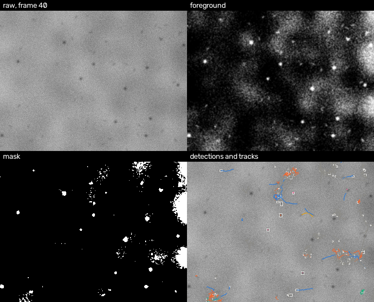
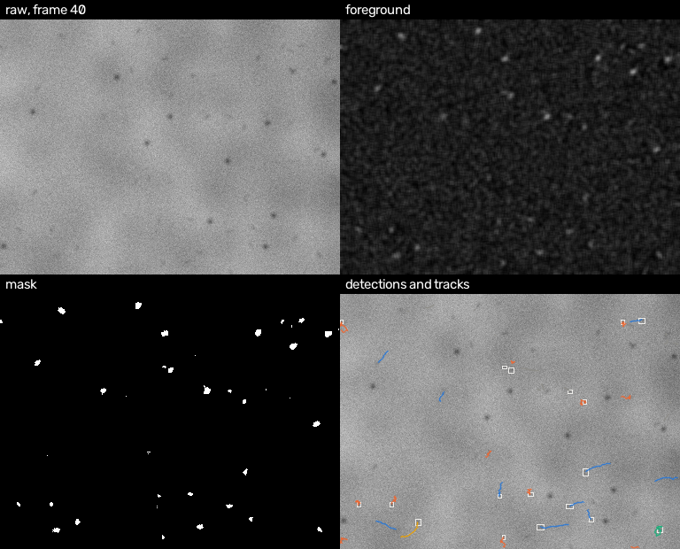
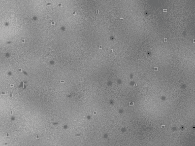

# The agentic calibration, measured

**[fact]** 2026-11-12, `mcv` 0.8.0. The agent is Claude, driving `mcv` through
a shell, as the [guide](../guide.md) says. One run of the agent; three seeds
for every search.

## The question

[ideas/calibration.md](../../ideas/calibration.md) asked: *on videos with a
known truth, does an agent with the toolkit reach a good tracking and
classification without a label, and beat a blind search given the same
truth?*

## The protocol

- **Three situations**, each standing for one researcher's video, in
  `settings/bench/`: dark swimmers among dust and uneven light
  (`phase-contrast-dust`), bright sparse cells on black
  (`fluorescence-sparse`), a dim, blurred, crowded drop (`dense-dim`).
- **A tuning video and an evaluation video** of each: the evaluation one has
  another seed, faster swimmers and a wandering heading. Every method tunes
  on the first; its final configuration is scored once on the second.
- **The score** is the mean of the MOTA and the classification accuracy:
  the tracks must be right, and so must the verdicts drawn from them.
- **The budget** is ten scored runs on the tuning video. The agent may run
  the pipeline as often as it likes on the video itself, without its truth:
  that is what a researcher's video allows. It used **5, 3 and 8** scored
  runs.
- **Calibration per video**: one configuration cannot serve dark and bright
  cells at once, so every method tunes each situation alone.

The baselines:

| Method | What it does |
| --- | --- |
| 2025 | the configuration the student tuned by eye on the study's video |
| [Probe](../tools.md#probe) | `mcv probe`'s suggestion, from measures alone, no truth |
| [Blind](../tools.md#search) | random draws over the whole space (`mcv search --strategy blind`) |
| Blind ×3 | the same with thirty runs |
| [Local](../tools.md#search) | steps around the 2025 configuration (`--strategy around`) |
| [Local from the probe](../tools.md#search) | steps around the probe's suggestion, the agent's own start |

## The results

Objective on the evaluation videos; the mean of three seeds for the
searches, their spread in brackets.

| Method | Dark and dust | Fluorescence | Dim and crowded |
| --- | ---: | ---: | ---: |
| 2025 | −0.59 | 0.00 | 0.00 |
| [Probe](../tools.md#probe) | 0.67 | 0.77 | −0.95 |
| [Blind](../tools.md#search) | 0.07 [−0.28, 0.48] | 0.56 [0.02, 0.85] | 0.00 [0.00, 0.00] |
| [Blind ×3](../tools.md#search) | 0.52 [0.30, 0.77] | 0.81 [0.75, 0.85] | 0.22 [0.00, 0.55] |
| [Local](../tools.md#search) | 0.20 [0.17, 0.22] | 0.62 [0.52, 0.81] | −0.11 [−0.30, 0.00] |
| [Local from the probe](../tools.md#search) | 0.76 [0.69, 0.80] | 0.78 [0.75, 0.84] | −0.15 [−0.46, 0.00] |
| **Agent** | **0.80** | **0.86** | **0.59** |

What it says:

- **Where a search finds the answer, the agent matches its best seed with
  fewer runs**: on the first two scenes the best seed of a fair baseline is
  within 0.01 of the agent, which used 5 and 3 runs against 10 and 30.
- **Where the answer is a change seen in the image, the agent is far ahead**:
  on the dim drop the foreground was the uneven background, not the cells.
  The agent saw it in one look and subtracted the background; a search that
  steps around numbers does not get there in ten runs, nor most of the time in
  thirty.
- **The probe alone is a strong start** on two scenes, and a bad one on the
  third: its suggestion is a hypothesis, never an answer.

## The agent's steps

Each line is one scored run on the tuning video, with the reason the agent
gave; the score is the tuning objective.

### Dim and crowded

| Step | Change | Why | Score |
| --- | --- | --- | ---: |
| 1 | the probe's suggestion | — | −0.13 |
| 2 | temporal-median background, window centred on 0.5, smoothing 5 | the foreground is the uneven background, not the cells | 0.54 |
| 3 | threshold 0.3 | the cells show at 0.3 to 0.4 but the mask keeps none | 0.63 |
| 4 | threshold 0.22 | precision 0.99, recall 0.5 | 0.36 |
| 5 | threshold 0.25, boxes of 6 px and more | 0.22 let the noise in as 1 px specks | **0.665** |
| 6 | coast 8 frames | 95 identity switches, faint cells blink | 0.658 |
| 7 | gate 7 px | a crowd at 2 px per frame | 0.655 |
| 8 | smoothing 3 | the cells are 2.5 px wide | −0.52 |

Kept: step 5, the best score, although step 6 halved the identity switches:
the score decides, not the agent's preference.




### Dark swimmers and dust

| Step | Change | Why | Score |
| --- | --- | --- | ---: |
| 1 | the probe's suggestion | — | 0.735 |
| 2 | boxes of 4 px and more | out-of-focus cells leave 2 × 2 px masks under min_area 12 | 0.799 |
| 3 | coast 6 frames | 27 identity switches among blinking swimmers | 0.801 |
| 4 | threshold 0.4 | precision still 1.0 | **0.836** |
| 5 | threshold 0.33 | find the edge | 0.818 |



### Fluorescence, sparse

| Step | Change | Why | Score |
| --- | --- | --- | ---: |
| 1 | the probe's suggestion | — | 0.647 |
| 2 | boxes of 6 px and more | masked cells without a box: min_area 23 from the mean object | **0.772** |
| 3 | gate 10 px | straight tails jumping between cells | 0.772 |

Step 3 changed nothing: the jumps came from the detections step 1 lost, and
went with them. The agent's diagnosis was wrong, and the score said so.

The final configurations are in [configurations/](configurations/).

## What the agent changed in the toolkit

Calibrating is also finding what the tools cannot do:

- **The probe saw nothing on a dim video**: it compared smoothed pixels to the
  raw noise. It now measures the noise of what it thresholds.
- **The probe's `min_area` is too high**, three times: it is set from the
  mean object, and out-of-focus cells are smaller. **[question]** set it from
  a low percentile instead.
- **No setting separated rods from the halos of beads** on the study's video:
  the exclusion of static objects was added ([case](../cases/salmonella.md)).

## The traps, checked

- **[caution]** One agent, one run per scene: the agent is not a seed. A
  second agent, or the same one again, may do better or worse.
- **[caution]** The agent knows the toolkit it wrote; another agent reads
  only the guide. The guide is what to improve if it does worse.
- **[caution]** Three synthetic scenes are a check of the method, not a
  proof: the scenes are 2D, rods only, and the agent wrote the renderer.
  The next truths are VISEM-Tracking and the AnDi benchmark
  ([catalogue](../../catalogue/sources.yaml)).

## Rerun it

```bash
mcv synth dense-dim --scene settings/bench/tuning/dense-dim.toml
mcv probe output/synthetic/dense-dim/frames
mcv bench --scene settings/bench/evaluation/dense-dim.toml \
    --config docs/benchmark/configurations/dense-dim-agent.toml
mcv search --scene settings/bench/tuning/dense-dim.toml --strategy blind \
    --budget 10 --seed 0 --config settings/default.toml
```
