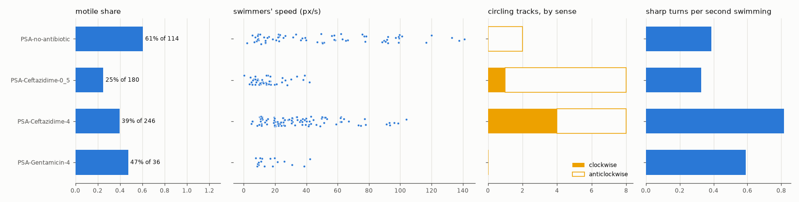
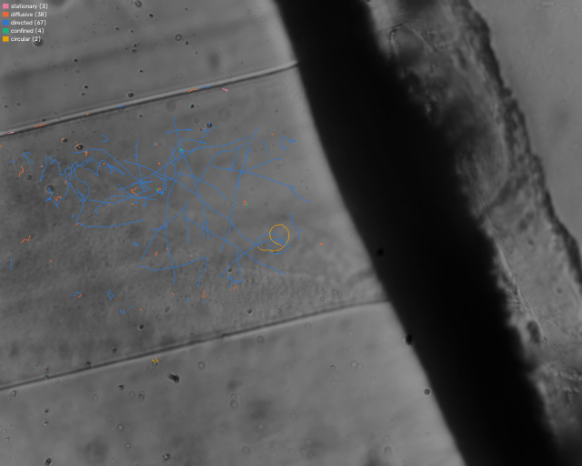
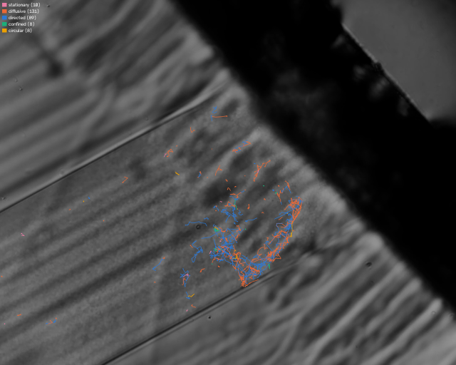

# Case: motility under antibiotics

**[fact]** 2026-11-14, by the agent. *Pseudomonas aeruginosa* swimming in a
capillary, filmed with a 3D-printed OpenFlexure microscope and a Raspberry Pi
camera, without antibiotic and under ceftazidime or gentamicin
([source](../../catalogue/sources.yaml), Zenodo 7249682, CC-BY 4.0). Does
motility fall under the drug?

## The videos

Four videos of 4500 frames at 25 fps, 1280 × 1024 px; the first 150 frames
(6 s) of each are read. No scale bar: speeds are in pixels per second, fit to
compare the conditions, not to give µm/s.

## The calibration

What the videos asked of the toolkit, each a tool now
([frictions](../../ideas/frictions.md)):

- **The light is uneven** on a low-cost microscope: an automatic mask hid half
  the cells. The inside of each capillary is traced by hand on a grid of the
  first frame, `preprocessing.mask.inside`.
- **The camera's exposure jumps**: up to 0.14 between two frames under
  ceftazidime 4, which became 2 000 false tracks. `even_exposure` scales every
  frame to the clip's median, and the probe now measures the jumps.
- Bacteria are dark dots of 5 × 3 px at a contrast of 0.05 over a noise of
  0.006: a window of 0.05 under the background, areas of 3 to 40 px.

The configurations are in [configurations/](configurations/).

| Without antibiotic | Ceftazidime 4 |
| --- | --- |
|  |  |

## What the drug does

| Condition | Classified | Motile share | Swimmers' median speed | Slower than untreated |
| --- | ---: | ---: | ---: | ---: |
| No antibiotic | 114 | 61 % | 47 px/s | — |
| Ceftazidime 0.5 | 180 | 25 % | 14 px/s | p = 1e-7 |
| Ceftazidime 4 | 246 | 39 % | 31 px/s | p = 0.04 |
| Gentamicin 4 | 36 | 47 % | 13 px/s | p = 7e-4 |

The p-values are one-sided Mann-Whitney tests of the swimmers' speeds against
the untreated ones.

- **Under every drug, swimmers are slower**, and fewer cells swim.
- **The dose does not order the effect**: ceftazidime 4 slows them less than
  0.5 does.

## What it cannot say

- **[caution]** One field of one capillary per condition: the fields differ in
  more than the drug (their depth, their light, the place in the capillary).
  The ceftazidime 4 video is also the one whose exposure jumped. A dose
  effect needs several fields per condition.
- **[caution]** 6 s of 3 min are read; the toolkit holds a whole video in
  memory, and these are 23 GB as floats. **[question]** Reading in windows, or
  at a lower resolution, is the planned fix.
- The *E. coli* videos of the same record (85 to 130 MB) are catalogued and
  not yet run.
