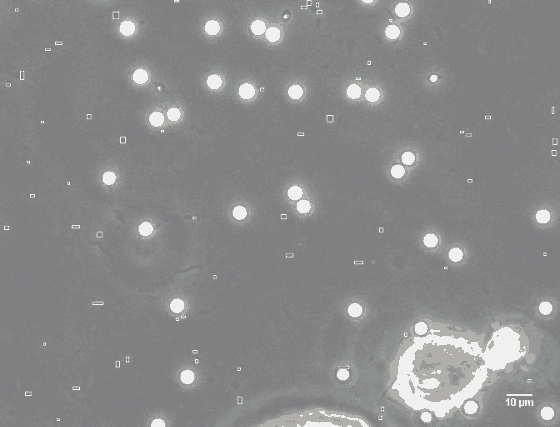
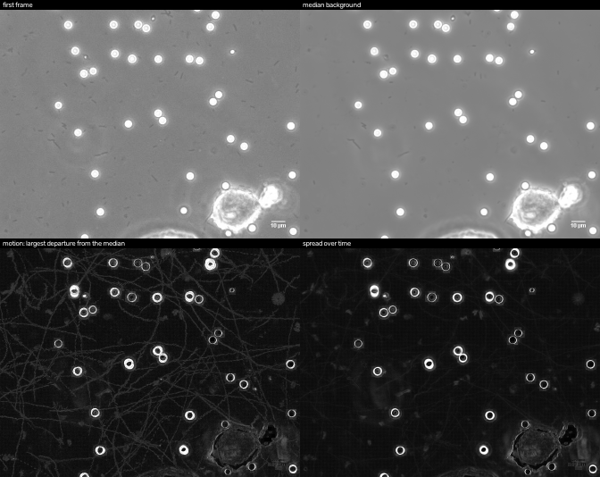
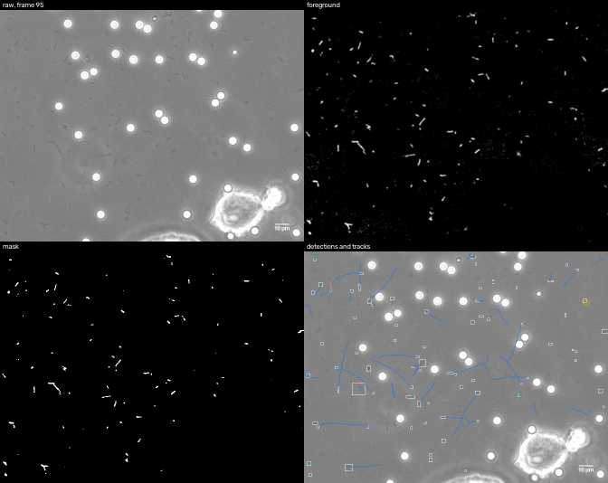
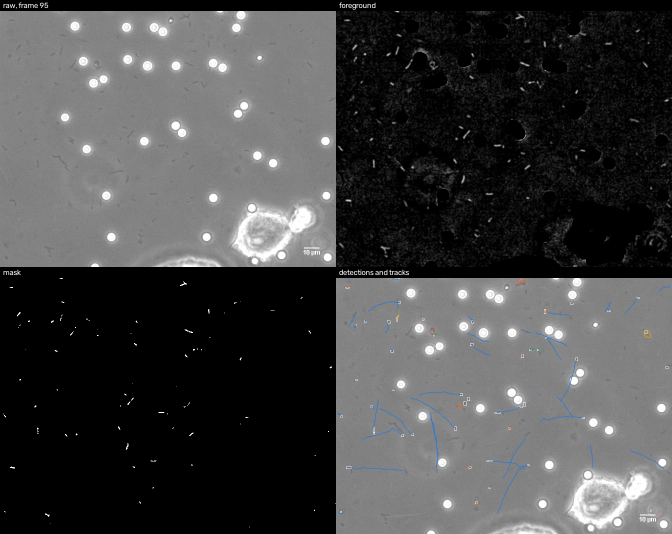
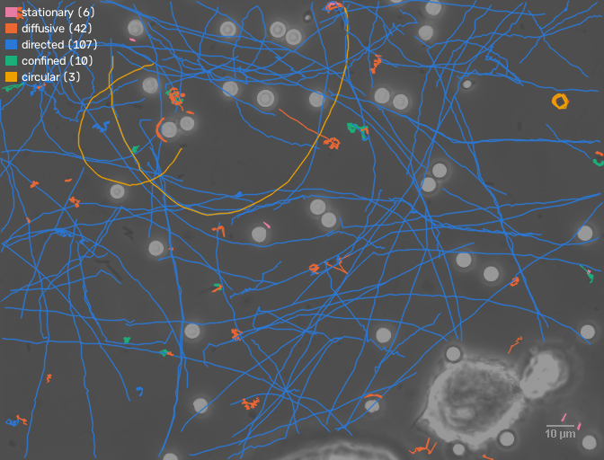
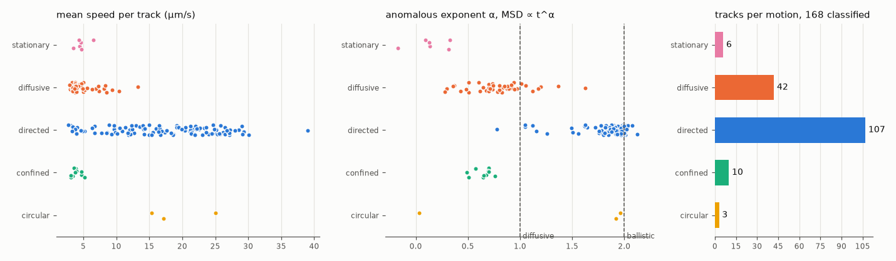
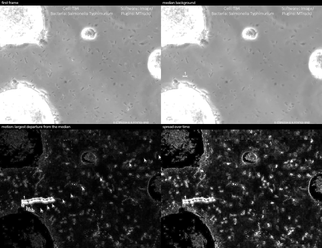

# Case: the study's Salmonella video

**[fact]** 2026-11-12, by the agent (Claude), with `mcv` 0.8.0. The video is
`342843.avi` of the 2025 study: *Salmonella* Typhimurium in phase contrast,
672 × 512 px, 191 frames at 11 fps, no truth.

## What the probe saw, and what it missed

`mcv probe` measured the noise (0.012) and a large static share (0.86), and
suggested a temporal-median background. It also said the objects are
**bright**: the strongest departures from the median are the halos of the
large bright discs, beads or host cells, which jitter. The motion view says
otherwise: the paths drawn across the frame are those of small **dark** rods.
A heuristic does not know what is being looked for; the agent does.

The frame carries a 10 µm scale bar, 31 px long: **0.323 µm per pixel**,
±3 %. The frame rate, 11 fps, is in the file.

## The runs

The journal is `mcv history data/342843.avi`; each run is a folder with its
looks.

| Run | Change | Why |
| --- | --- | --- |
| 002 | polarity dark, window 0.08 under the background, boxes 6 to 60 px | the bacteria are the dark rods; the window is six noise deviations |
| 003 | an opening of radius 1 | each disc leaves 1 px crescents of its halo in the mask |
| 004 | **exclude the static objects** above 0.15, margin 4 px | boxes stay on the discs' dark inner ring: no threshold or area separates them |
| 005 | no opening | it eroded the 2 px rods; with the discs excluded it had no job |
| 006 | coast 6 frames | the rods swim in and out of focus |

Run 004 is a change of structure, not of a number: the exclusion of static
objects did not exist, and was added to the library for this video
(`preprocessing.mask.static`). It is general: beads, host cells, debris
and burnt-in scale bars all qualify.

| The 2025 configuration | The agent's |
| --- | --- |
|  |  |

The configuration is [salmonella-342843.toml](salmonella-342843.toml).

## What it found, on the whole video

- 168 tracks long enough to classify: **107 directed** swimmers at a median
  of **18.3 µm/s**, α near 2, and **42 diffusive** cells at 3 to 6 µm/s with
  α near 1, non-motile or stuck. The two populations separate on α alone.
- The speed of a diffusive track is not a velocity: it grows as the frame
  interval shrinks. Read its diffusion coefficient instead.

## Checked on a twin

There is no truth for this video, so the agent rendered one that looks like
it, [salmonella-twin.toml](salmonella-twin.toml): 50 dark rods of 8 × 3 px
swimming at 6.2 px per frame (22 µm/s), 20 diffusing, the measured noise.

| Configuration | Objective | MOTA | Accuracy | Precision | Recall |
| --- | ---: | ---: | ---: | ---: | ---: |
| 2025 | 0.19 | −0.30 | 0.68 | 0.41 | 0.60 |
| The probe's suggestion | 0.00 | 0.00 | 0.00 | 0.00 | 0.00 |
| **The agent's** | **0.84** | **0.76** | **0.91** | **1.00** | **0.76** |

**[caution]** The twin was built after the agent looked: it checks that the
configuration recovers cells *like those the agent believes are there*, not
the belief. It has no discs, so the exclusion is not tested on it.

## Against the 2025 configuration, honestly

The 2025 configuration was tuned by eye on this very video, and it works on
it: 114 directed tracks against the agent's 107, 15.4 µm/s once converted.
Where it differs: it counts 29 "confined" tracks, most of them dust that
jitters, against 10; it gives pixels per second; and on any other video it
fails ([benchmark](../benchmark/calibration.md)).

## The eight other videos

The same configuration on the eight other videos gives very different
mixtures, from mostly directed (`342737`) to mostly diffusive (`342655`).
Before reading biology into that, the agent probed `342655`:

Another experiment: bacteria among T84 host cells, at 20 fps, with a 5 µm bar
(0.37 µm per pixel, not 0.323), burnt-in text, mouse cursors, and a manual
MTrackJ track drawn over the video. The bacteria there jiggle against the
cells rather than swim. **A configuration does not transfer between
experiments**: each video is probed, and its scale read, before its numbers
are trusted.
