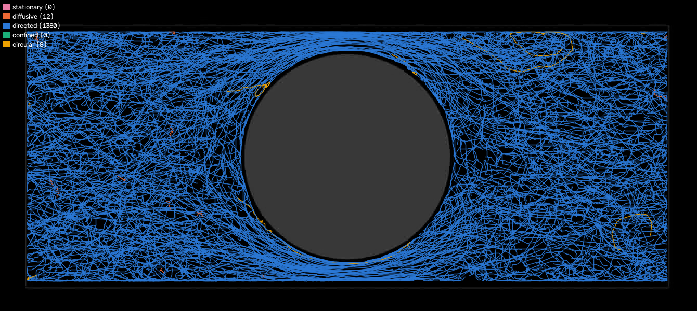
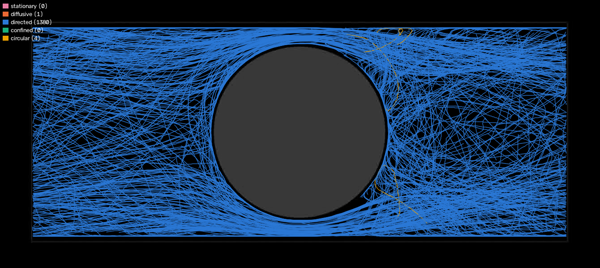

# Case: simulated run-and-tumble

**[fact]** 2026-11-14, by the agent. Three videos of simulated swimmers in a
channel, whose mean run time between two tumbles is known: 0.3, 3.7 and 21 s
([source](../../catalogue/sources.yaml), simulated-run-and-tumble, CC-BY 4.0).
Does the tumbling test find more tumbles where runs are shorter?

| Runs of 0.3 s | Runs of 21 s |
| --- | --- |
|  |  |

## The videos

About 720 frames each, 31 s, 1340 × 600 px, around 110 swimmers in view and
a round obstacle in the channel. The swimmers are bright rods of 7 × 4 px,
striped by the compression.

## The calibration

One configuration for the three, derived from the probe's suggestion on the
3.7 s video ([configuration](configurations/simulated-run-and-tumble.toml)):

- a temporal median removes the obstacle and the channel walls;
- bright polarity, a window from 0.55 to 0.8, areas of 4 to 112 px, so a
  striped rod stays one detection;
- an assignment distance of 12 px.

Each run took about 80 s and 11 GB of memory, queued in the background
([assisted research](../../ideas/assisted-research.md)).

## The tumbles found

| Mean run time | Classified tracks | Directed | Persistent tracks | With a tumble |
| ---: | ---: | ---: | ---: | ---: |
| 0.3 s | 1400 | 99 % | 1034 | 51 % |
| 3.7 s | 1303 | 99 % | 959 | 19 % |
| 21 s | 1385 | 99 % | 1038 | 6 % |

- **The share of tracks with a tumble falls with the run time**, in the
  order of the truth, with one configuration for all three.
- Nearly every swimmer is directed, as simulated; the 6 % at 21 s is the
  test's floor here: a track rarely holds a tumble when runs last longer
  than the clip.

## What it cannot say

- **[caution]** The tracks are short, a median of 15 frames (about 0.6 s):
  swimmers cross and the tracker breaks them. The test sees whether a short
  window holds a tumble, so it ranks the three videos without measuring the
  run time itself. **[question]** A rate per second needs longer tracks, a
  tracker that keeps identities through crossings.
- **[caution]** Speeds are in pixels; the median grows from 70 to 137 px/s
  with the run time, likely because a tumble inside a frame step shortens
  the displacement.

## Near the obstacle

The trajectories seem to follow the obstacle's wall. With the disc masked as
decor ([configuration](configurations/simulated-obstacle.toml)),
`mcv interactions` compares the real tracks with the same tracks moved at
random across the frame:

- **Not held**: 2.6 % of the swimmers' positions lie within 10 px of the disc,
  as many as for the moved tracks (p = 0.38).
- **Not slowed**: their speed does not fall near the disc (p = 1.0).

The eye saw a pattern that chance draws as often. This run also found a bug:
the slowing test read the wrong tail, and called "slowed" what was faster.
