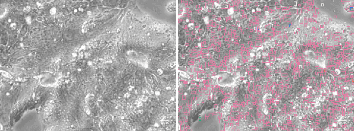
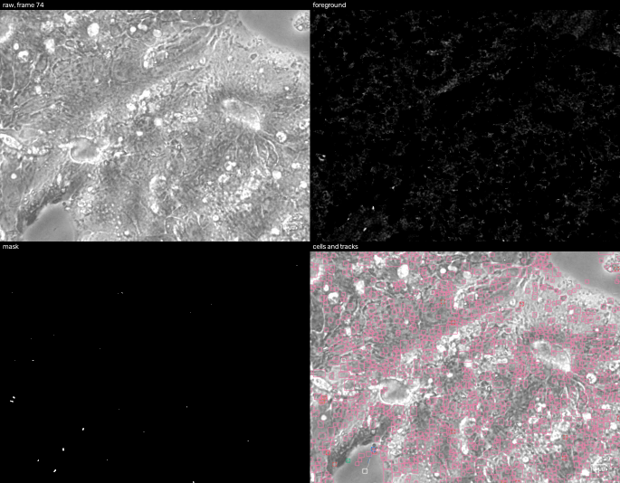
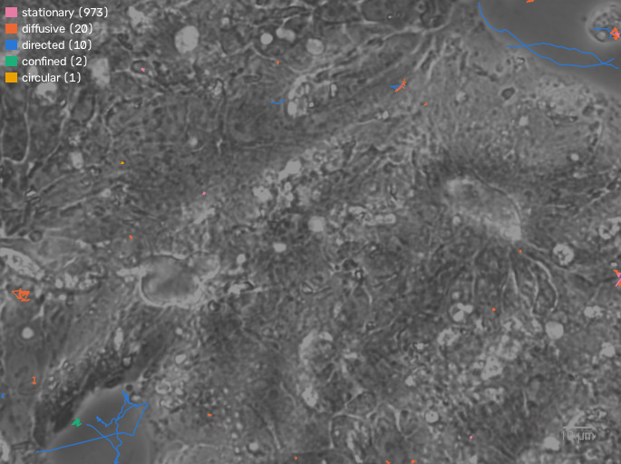
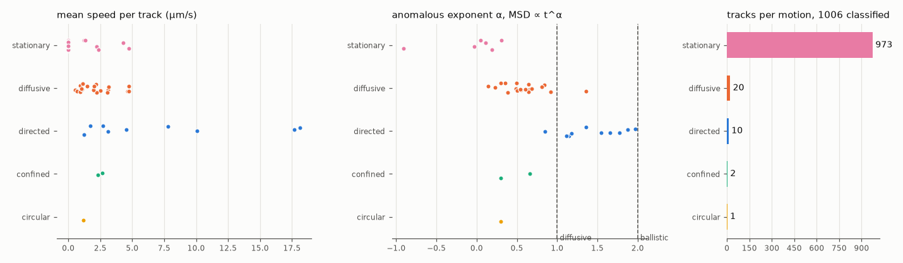

# Video 342430

**Why this configuration**: the configuration calibrated on 342843, rods
measured in pixels, still cells found in the median; 0.333 µm per pixel: 10 µm
bar of 30 px, read on the probe's crop

| Measure | Value |
| --- | --- |
| frames | 150 |
| detections per frame | 19 (10 % 9, 90 % 37) |
| tracks | 1494, 1006 classified |
| observations per track | 150 (10 % 1, 90 % 150) |
| motions | 973 stationary, 20 diffusive, 10 directed, 2 confined, 1 circular, 488 undetermined |
| speed (µm/s) | 0 (10 % 0, 90 % 0) |
| anomalous exponent α | 0.603 (10 % 0.138, 90 % 1.57) |
| diffusion (µm²/s) | 0.0344 (10 % 0.00364, 90 % 0.375) |

| Hypothesis | Tracks tested | Null rejected | Share |
| --- | ---: | ---: | ---: |
| anomalous | 991 | 972 | 98% |
| persistent | 3 | 3 | 100% |
| chiral | 3 | 0 | 0% |
| non-gaussian | 38 | 17 | 45% |
| tumbling | 3 | 0 | 0% |
| periodic | 998 | 0 | 0% |
| confined | 991 | 967 | 98% |

- the detections per frame vary a lot: cells cross the threshold in and out;
smooth more, or lower detection.threshold
- most classified tracks are stationary: dust or stuck cells; try
preprocessing.background = temporal-median

The 25 longest classified tracks:

| Track | Length | Motion | Confidence | α | Speed (µm/s) |
| --- | --- | --- | --- | --- | --- |
| 527 | 150 | stationary | 1.00 | none | 0 |
| 528 | 150 | stationary | 1.00 | none | 0 |
| 529 | 150 | stationary | 1.00 | none | 0 |
| 530 | 150 | stationary | 1.00 | none | 0 |
| 531 | 150 | stationary | 1.00 | none | 0 |
| 532 | 150 | stationary | 1.00 | none | 0 |
| 533 | 150 | stationary | 1.00 | none | 0 |
| 534 | 150 | stationary | 1.00 | none | 0 |
| 535 | 150 | stationary | 1.00 | none | 0 |
| 536 | 150 | stationary | 1.00 | none | 0 |
| 537 | 150 | stationary | 1.00 | none | 0 |
| 538 | 150 | stationary | 1.00 | none | 0 |
| 539 | 150 | stationary | 1.00 | none | 0 |
| 540 | 150 | stationary | 1.00 | none | 0 |
| 541 | 150 | stationary | 1.00 | none | 0 |
| 542 | 150 | stationary | 1.00 | none | 0 |
| 543 | 150 | stationary | 1.00 | none | 0 |
| 544 | 150 | stationary | 1.00 | none | 0 |
| 545 | 150 | stationary | 1.00 | none | 0 |
| 546 | 150 | stationary | 1.00 | none | 0 |
| 547 | 150 | stationary | 1.00 | none | 0 |
| 548 | 150 | stationary | 1.00 | none | 0 |
| 549 | 150 | stationary | 1.00 | none | 0 |
| 550 | 150 | stationary | 1.00 | none | 0 |
| 551 | 150 | stationary | 1.00 | none | 0 |

The configuration is `configuration.toml`; the tracks, `tracks.csv`; every
verdict, `verdicts.csv`.
