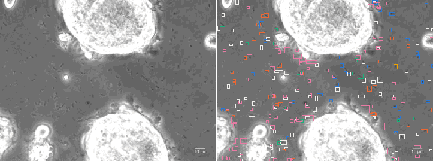
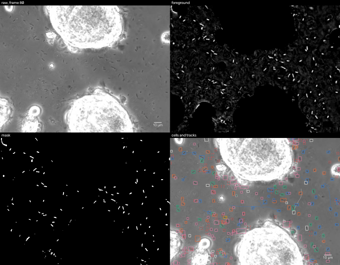
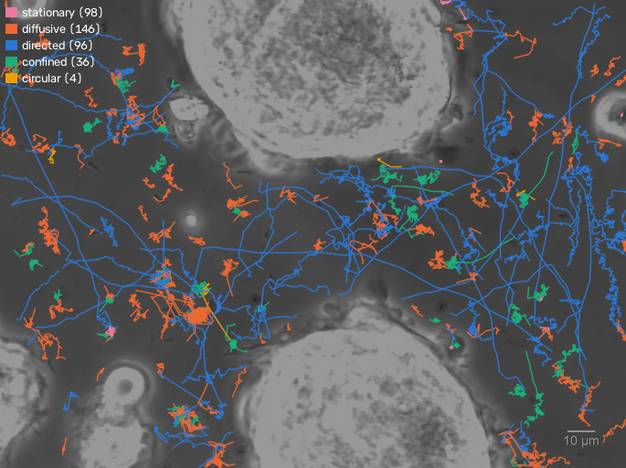
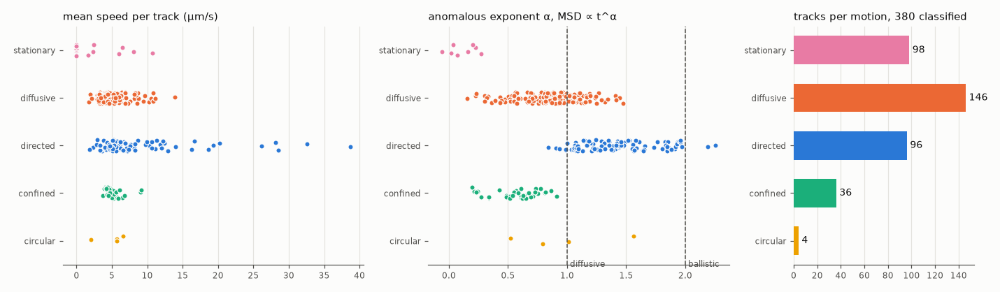

# Video 342517

**Why this configuration**: the configuration calibrated on 342843, rods
measured in pixels, still cells found in the median; 0.333 µm per pixel: 10 µm
bar of 28 to 30 px

| Measure | Value |
| --- | --- |
| frames | 161 |
| detections per frame | 131 (10 % 119, 90 % 147) |
| tracks | 1738, 380 classified |
| observations per track | 2 (10 % 1, 90 % 66.6) |
| motions | 98 stationary, 146 diffusive, 96 directed, 36 confined, 4 circular, 1358 undetermined |
| speed (µm/s) | 4.65 (10 % 0, 90 % 8.48) |
| anomalous exponent α | 0.945 (10 % 0.455, 90 % 1.58) |
| diffusion (µm²/s) | 0.714 (10 % 0.245, 90 % 2.99) |

| Hypothesis | Tracks tested | Null rejected | Share |
| --- | ---: | ---: | ---: |
| anomalous | 278 | 145 | 52% |
| persistent | 111 | 26 | 23% |
| chiral | 111 | 0 | 0% |
| non-gaussian | 290 | 129 | 44% |
| tumbling | 26 | 7 | 27% |
| periodic | 326 | 0 | 0% |
| confined | 278 | 95 | 34% |

No hint: the numbers look sane.

The 25 longest classified tracks:

| Track | Length | Motion | Confidence | α | Speed (µm/s) |
| --- | --- | --- | --- | --- | --- |
| 1648 | 161 | stationary | 1.00 | none | 0 |
| 1649 | 161 | stationary | 1.00 | none | 0 |
| 1650 | 161 | stationary | 1.00 | none | 0 |
| 1651 | 161 | stationary | 1.00 | none | 0 |
| 1652 | 161 | stationary | 1.00 | none | 0 |
| 1653 | 161 | stationary | 1.00 | none | 0 |
| 1654 | 161 | stationary | 1.00 | none | 0 |
| 1655 | 161 | stationary | 1.00 | none | 0 |
| 1656 | 161 | stationary | 1.00 | none | 0 |
| 1657 | 161 | stationary | 1.00 | none | 0 |
| 1658 | 161 | stationary | 1.00 | none | 0 |
| 1659 | 161 | stationary | 1.00 | none | 0 |
| 1660 | 161 | stationary | 1.00 | none | 0 |
| 1661 | 161 | stationary | 1.00 | none | 0 |
| 1662 | 161 | stationary | 1.00 | none | 0 |
| 1663 | 161 | stationary | 1.00 | none | 0 |
| 1664 | 161 | stationary | 1.00 | none | 0 |
| 1665 | 161 | stationary | 1.00 | none | 0 |
| 1666 | 161 | stationary | 1.00 | none | 0 |
| 1667 | 161 | stationary | 1.00 | none | 0 |
| 1668 | 161 | stationary | 1.00 | none | 0 |
| 1669 | 161 | stationary | 1.00 | none | 0 |
| 1670 | 161 | stationary | 1.00 | none | 0 |
| 1671 | 161 | stationary | 1.00 | none | 0 |
| 1672 | 161 | stationary | 1.00 | none | 0 |

The configuration is `configuration.toml`; the tracks, `tracks.csv`; every
verdict, `verdicts.csv`.
