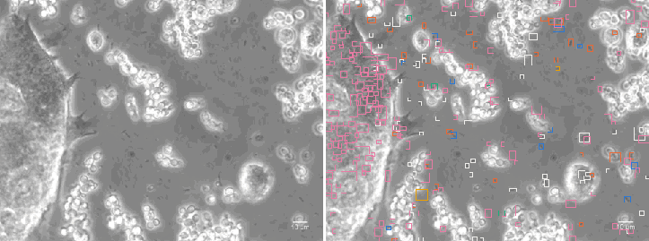
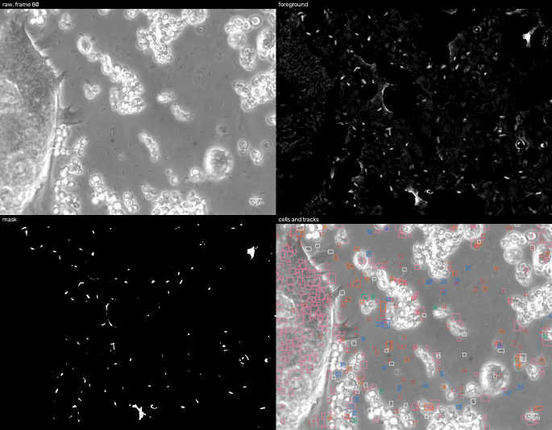
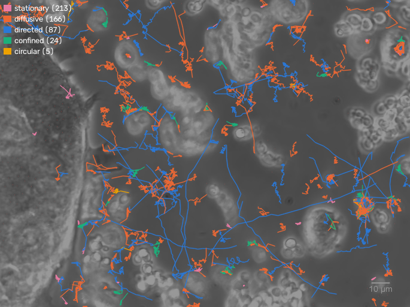
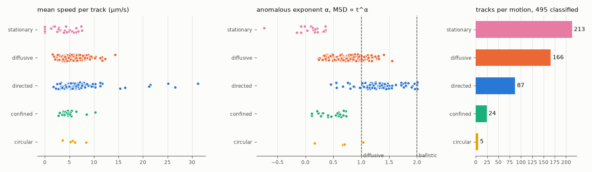

# Video 342580

**Why this configuration**: the configuration calibrated on 342843, rods
measured in pixels, still cells found in the median; 0.333 µm per pixel: 10 µm
bar of 30 px

| Measure | Value |
| --- | --- |
| frames | 161 |
| detections per frame | 134 (10 % 111, 90 % 161) |
| tracks | 2731, 495 classified |
| observations per track | 3 (10 % 1, 90 % 49) |
| motions | 213 stationary, 166 diffusive, 87 directed, 24 confined, 5 circular, 2236 undetermined |
| speed (µm/s) | 3.99 (10 % 0, 90 % 7.74) |
| anomalous exponent α | 0.861 (10 % 0.335, 90 % 1.42) |
| diffusion (µm²/s) | 0.941 (10 % 0.204, 90 % 3.31) |

| Hypothesis | Tracks tested | Null rejected | Share |
| --- | ---: | ---: | ---: |
| anomalous | 363 | 221 | 61% |
| persistent | 59 | 3 | 5% |
| chiral | 59 | 0 | 0% |
| non-gaussian | 297 | 161 | 54% |
| tumbling | 3 | 0 | 0% |
| periodic | 429 | 0 | 0% |
| confined | 363 | 194 | 53% |

- most tracks are shorter than 20 observations: the tracker loses them; raise
tracking.max_assignment_distance or max_missed_frames, or look for blinking
detections

The 25 longest classified tracks:

| Track | Length | Motion | Confidence | α | Speed (µm/s) |
| --- | --- | --- | --- | --- | --- |
| 18 | 161 | directed | 1.00 | 1.12 [1.07, 1.16] | 3.27 |
| 2538 | 161 | stationary | 1.00 | none | 0 |
| 2539 | 161 | stationary | 1.00 | none | 0 |
| 2540 | 161 | stationary | 1.00 | none | 0 |
| 2541 | 161 | stationary | 1.00 | none | 0 |
| 2542 | 161 | stationary | 1.00 | none | 0 |
| 2543 | 161 | stationary | 1.00 | none | 0 |
| 2544 | 161 | stationary | 1.00 | none | 0 |
| 2545 | 161 | stationary | 1.00 | none | 0 |
| 2546 | 161 | stationary | 1.00 | none | 0 |
| 2547 | 161 | stationary | 1.00 | none | 0 |
| 2548 | 161 | stationary | 1.00 | none | 0 |
| 2549 | 161 | stationary | 1.00 | none | 0 |
| 2550 | 161 | stationary | 1.00 | none | 0 |
| 2551 | 161 | stationary | 1.00 | none | 0 |
| 2552 | 161 | stationary | 1.00 | none | 0 |
| 2553 | 161 | stationary | 1.00 | none | 0 |
| 2554 | 161 | stationary | 1.00 | none | 0 |
| 2555 | 161 | stationary | 1.00 | none | 0 |
| 2556 | 161 | stationary | 1.00 | none | 0 |
| 2557 | 161 | stationary | 1.00 | none | 0 |
| 2558 | 161 | stationary | 1.00 | none | 0 |
| 2559 | 161 | stationary | 1.00 | none | 0 |
| 2560 | 161 | stationary | 1.00 | none | 0 |
| 2561 | 161 | stationary | 1.00 | none | 0 |

The configuration is `configuration.toml`; the tracks, `tracks.csv`; every
verdict, `verdicts.csv`.
