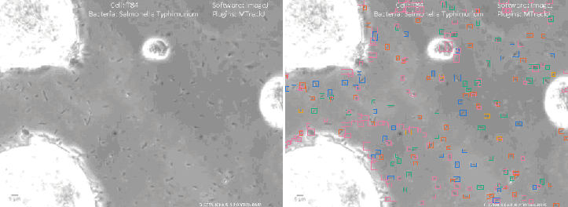
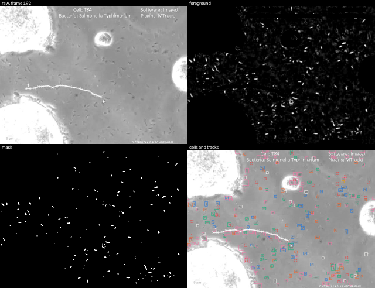
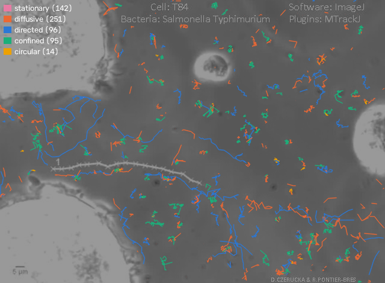
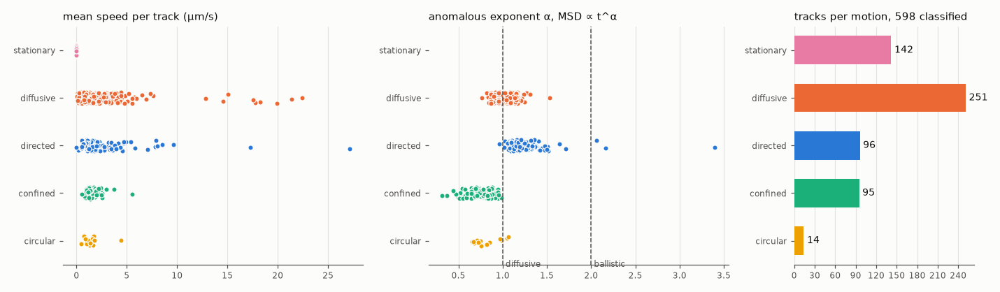

# Video 342655

**Why this configuration**: the configuration calibrated on 342843, rods
measured in pixels, still cells found in the median; 0.37 µm per pixel: 5 µm bar
of 13.5 px, grey, measured by hand

| Measure | Value |
| --- | --- |
| frames | 385 |
| detections per frame | 145 (10 % 135, 90 % 151) |
| tracks | 1115, 598 classified |
| observations per track | 25 (10 % 7, 90 % 385) |
| motions | 142 stationary, 251 diffusive, 96 directed, 95 confined, 14 circular, 517 undetermined |
| speed (µm/s) | 1.13 (10 % 0, 90 % 3.55) |
| anomalous exponent α | 1.02 (10 % 0.749, 90 % 1.21) |
| diffusion (µm²/s) | 0.316 (10 % 0.0619, 90 % 4.64) |

| Hypothesis | Tracks tested | Null rejected | Share |
| --- | ---: | ---: | ---: |
| anomalous | 484 | 194 | 40% |
| persistent | 20 | 6 | 30% |
| chiral | 20 | 0 | 0% |
| non-gaussian | 455 | 455 | 100% |
| tumbling | 6 | 2 | 33% |
| periodic | 556 | 77 | 14% |
| confined | 484 | 178 | 37% |

No hint: the numbers look sane.

The 25 longest classified tracks:

| Track | Length | Motion | Confidence | α | Speed (µm/s) |
| --- | --- | --- | --- | --- | --- |
| 1 | 385 | confined | 1.00 | 0.73 [0.69, 0.78] | 1.43 |
| 11 | 385 | diffusive | 0.57 | 1.04 [1.02, 1.06] | 1.19 |
| 19 | 385 | confined | 1.00 | 0.89 [0.88, 0.91] | 1.19 |
| 25 | 385 | directed | 1.00 | 1.22 [1.18, 1.25] | 1.32 |
| 37 | 385 | directed | 1.00 | 1.40 [1.38, 1.42] | 1.82 |
| 40 | 385 | directed | 0.92 | 1.10 [1.08, 1.12] | 1.05 |
| 44 | 385 | diffusive | 0.47 | 0.99 [0.98, 1.00] | 1.23 |
| 48 | 385 | directed | 1.00 | 1.11 [1.10, 1.12] | 1.5 |
| 56 | 385 | diffusive | 0.56 | 1.03 [1.02, 1.05] | 1.13 |
| 62 | 385 | confined | 1.00 | 0.88 [0.87, 0.89] | 1.33 |
| 68 | 385 | confined | 1.00 | 0.88 [0.87, 0.89] | 1.37 |
| 73 | 385 | confined | 1.00 | 0.94 [0.92, 0.97] | 1.21 |
| 76 | 385 | confined | 1.00 | 0.64 [0.62, 0.67] | 1.88 |
| 95 | 385 | directed | 1.00 | 1.17 [1.14, 1.21] | 1.01 |
| 105 | 385 | directed | 0.99 | 1.08 [1.05, 1.12] | 1.94 |
| 108 | 385 | directed | 1.00 | 1.20 [1.17, 1.22] | 1.07 |
| 115 | 385 | confined | 1.00 | 0.71 [0.69, 0.73] | 1.94 |
| 116 | 385 | confined | 1.00 | 0.91 [0.91, 0.92] | 1.16 |
| 119 | 385 | directed | 1.00 | 1.20 [1.17, 1.23] | 1.17 |
| 127 | 385 | confined | 1.00 | 0.88 [0.87, 0.90] | 1.72 |
| 129 | 385 | diffusive | 0.47 | 1.03 [1.02, 1.04] | 2.17 |
| 131 | 385 | confined | 1.00 | 0.78 [0.76, 0.79] | 1.43 |
| 1004 | 385 | stationary | 1.00 | none | 0 |
| 1005 | 385 | stationary | 1.00 | none | 0 |
| 1006 | 385 | stationary | 1.00 | none | 0 |

The configuration is `configuration.toml`; the tracks, `tracks.csv`; every
verdict, `verdicts.csv`.
