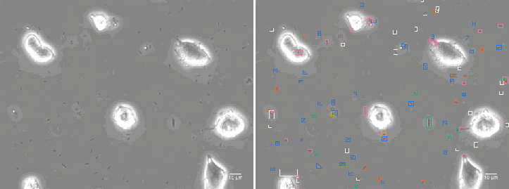
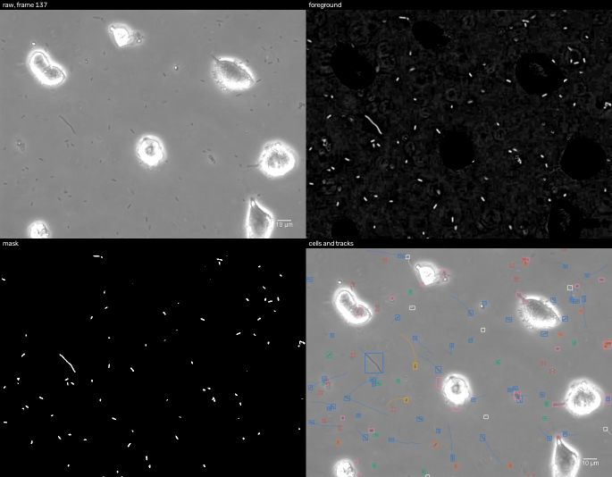
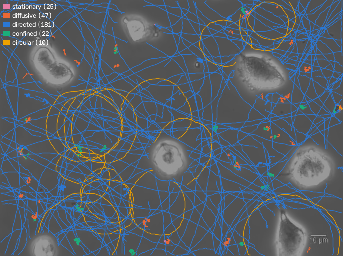
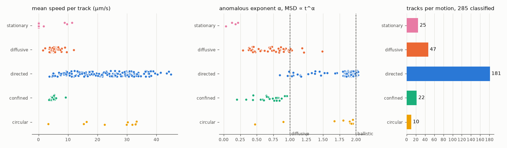

# Video 342737

**Why this configuration**: the configuration calibrated on 342843, rods
measured in pixels, still cells found in the median; 0.333 µm per pixel: 10 µm
bar of 30 px

| Measure | Value |
| --- | --- |
| frames | 275 |
| detections per frame | 79 (10 % 69, 90 % 87) |
| tracks | 563, 285 classified |
| observations per track | 20 (10 % 1, 90 % 134) |
| motions | 25 stationary, 47 diffusive, 181 directed, 22 confined, 10 circular, 278 undetermined |
| speed (µm/s) | 14.8 (10 % 3.67, 90 % 34.7) |
| anomalous exponent α | 1.91 (10 % 0.609, 90 % 2) |
| diffusion (µm²/s) | 0.279 (10 % 0.12, 90 % 0.713) |

| Hypothesis | Tracks tested | Null rejected | Share |
| --- | ---: | ---: | ---: |
| anomalous | 218 | 168 | 77% |
| persistent | 150 | 149 | 99% |
| chiral | 150 | 22 | 15% |
| non-gaussian | 264 | 114 | 43% |
| tumbling | 149 | 26 | 17% |
| periodic | 248 | 0 | 0% |
| confined | 218 | 28 | 13% |

No hint: the numbers look sane.

The 25 longest classified tracks:

| Track | Length | Motion | Confidence | α | Speed (µm/s) |
| --- | --- | --- | --- | --- | --- |
| 71 | 275 | diffusive | 0.51 | 1.00 [0.99, 1.01] | 4.58 |
| 542 | 275 | stationary | 1.00 | none | 0 |
| 543 | 275 | stationary | 1.00 | none | 0 |
| 544 | 275 | stationary | 1.00 | none | 0 |
| 545 | 275 | stationary | 1.00 | none | 0 |
| 546 | 275 | stationary | 1.00 | none | 0 |
| 547 | 275 | stationary | 1.00 | none | 0 |
| 548 | 275 | stationary | 1.00 | none | 0 |
| 549 | 275 | stationary | 1.00 | none | 0 |
| 550 | 275 | stationary | 1.00 | none | 0 |
| 551 | 275 | stationary | 1.00 | none | 0 |
| 552 | 275 | stationary | 1.00 | none | 0 |
| 553 | 275 | stationary | 1.00 | none | 0 |
| 554 | 275 | stationary | 1.00 | none | 0 |
| 555 | 275 | stationary | 1.00 | none | 0 |
| 556 | 275 | stationary | 1.00 | none | 0 |
| 557 | 275 | stationary | 1.00 | none | 0 |
| 558 | 275 | stationary | 1.00 | none | 0 |
| 559 | 275 | stationary | 1.00 | none | 0 |
| 560 | 275 | stationary | 1.00 | none | 0 |
| 561 | 275 | stationary | 1.00 | none | 0 |
| 562 | 275 | stationary | 1.00 | none | 0 |
| 56 | 274 | confined | 1.00 | 0.81 [0.79, 0.82] | 4.4 |
| 90 | 273 | circular | 1.00 | 0.47 [0.20, 0.74] | 33.3 |
| 53 | 271 | directed | 1.00 | 1.38 [1.35, 1.40] | 4.57 |

The configuration is `configuration.toml`; the tracks, `tracks.csv`; every
verdict, `verdicts.csv`.
