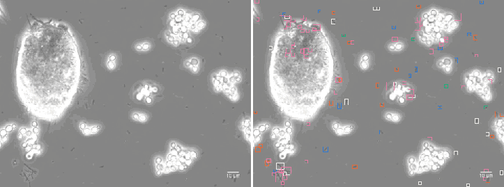
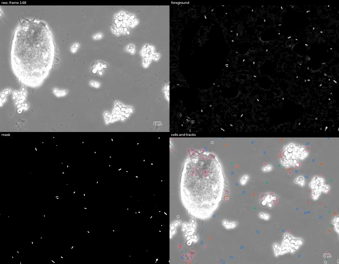
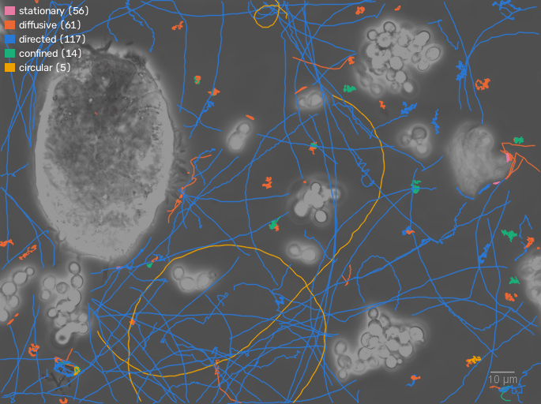
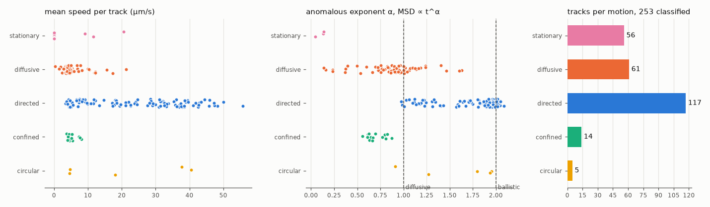

# Video 342783

**Why this configuration**: the configuration calibrated on 342843, rods
measured in pixels, still cells found in the median; 0.333 µm per pixel: 10 µm
bar of 30 px

| Measure | Value |
| --- | --- |
| frames | 297 |
| detections per frame | 56 (10 % 50, 90 % 63) |
| tracks | 598, 253 classified |
| observations per track | 14 (10 % 1, 90 % 291) |
| motions | 56 stationary, 61 diffusive, 117 directed, 14 confined, 5 circular, 345 undetermined |
| speed (µm/s) | 5.44 (10 % 0, 90 % 37.6) |
| anomalous exponent α | 1.45 (10 % 0.662, 90 % 2) |
| diffusion (µm²/s) | 0.305 (10 % 0.0668, 90 % 3.53) |

| Hypothesis | Tracks tested | Null rejected | Share |
| --- | ---: | ---: | ---: |
| anomalous | 186 | 129 | 69% |
| persistent | 57 | 53 | 93% |
| chiral | 57 | 12 | 21% |
| non-gaussian | 200 | 80 | 40% |
| tumbling | 53 | 8 | 15% |
| periodic | 206 | 0 | 0% |
| confined | 186 | 57 | 31% |

No hint: the numbers look sane.

The 25 longest classified tracks:

| Track | Length | Motion | Confidence | α | Speed (µm/s) |
| --- | --- | --- | --- | --- | --- |
| 17 | 297 | directed | 1.00 | 1.18 [1.16, 1.20] | 3.37 |
| 24 | 297 | diffusive | 0.54 | 0.96 [0.93, 1.00] | 3.74 |
| 32 | 297 | confined | 1.00 | 0.81 [0.79, 0.83] | 4.72 |
| 34 | 297 | diffusive | 0.48 | 0.97 [0.95, 0.98] | 3.23 |
| 545 | 297 | stationary | 1.00 | none | 0 |
| 546 | 297 | stationary | 1.00 | none | 0 |
| 547 | 297 | stationary | 1.00 | none | 0 |
| 548 | 297 | stationary | 1.00 | none | 0 |
| 549 | 297 | stationary | 1.00 | none | 0 |
| 550 | 297 | stationary | 1.00 | none | 0 |
| 551 | 297 | stationary | 1.00 | none | 0 |
| 552 | 297 | stationary | 1.00 | none | 0 |
| 553 | 297 | stationary | 1.00 | none | 0 |
| 554 | 297 | stationary | 1.00 | none | 0 |
| 555 | 297 | stationary | 1.00 | none | 0 |
| 556 | 297 | stationary | 1.00 | none | 0 |
| 557 | 297 | stationary | 1.00 | none | 0 |
| 558 | 297 | stationary | 1.00 | none | 0 |
| 559 | 297 | stationary | 1.00 | none | 0 |
| 560 | 297 | stationary | 1.00 | none | 0 |
| 561 | 297 | stationary | 1.00 | none | 0 |
| 562 | 297 | stationary | 1.00 | none | 0 |
| 563 | 297 | stationary | 1.00 | none | 0 |
| 564 | 297 | stationary | 1.00 | none | 0 |
| 565 | 297 | stationary | 1.00 | none | 0 |

The configuration is `configuration.toml`; the tracks, `tracks.csv`; every
verdict, `verdicts.csv`.
