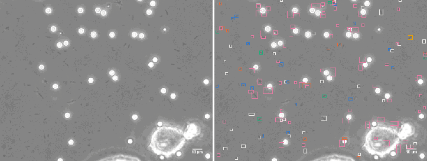
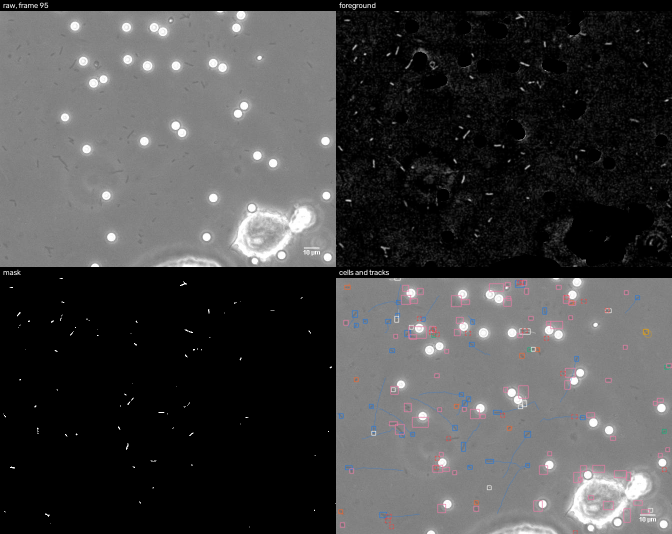
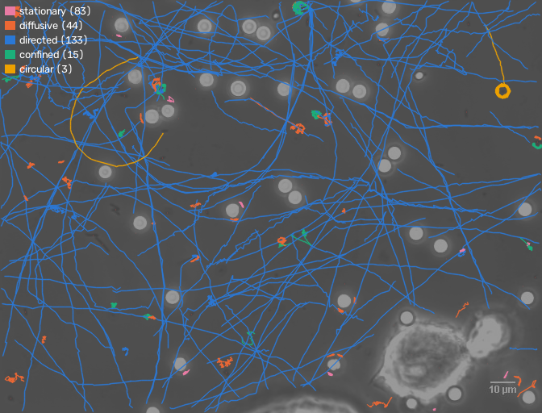
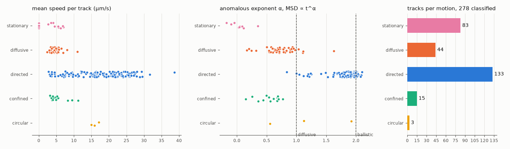

# Video 342843

**Why this configuration**: the configuration calibrated on 342843, rods
measured in pixels, still cells found in the median; 0.323 µm per pixel: 10 µm
bar of 31 px

| Measure | Value |
| --- | --- |
| frames | 191 |
| detections per frame | 67 (10 % 58, 90 % 79) |
| tracks | 883, 278 classified |
| observations per track | 8 (10 % 1, 90 % 90.2) |
| motions | 83 stationary, 44 diffusive, 133 directed, 15 confined, 3 circular, 605 undetermined |
| speed (µm/s) | 5.62 (10 % 0, 90 % 24.3) |
| anomalous exponent α | 1.84 (10 % 0.54, 90 % 2) |
| diffusion (µm²/s) | 0.255 (10 % 0.121, 90 % 1.27) |

| Hypothesis | Tracks tested | Null rejected | Share |
| --- | ---: | ---: | ---: |
| anomalous | 189 | 148 | 78% |
| persistent | 88 | 80 | 91% |
| chiral | 88 | 12 | 14% |
| non-gaussian | 204 | 60 | 29% |
| tumbling | 80 | 15 | 19% |
| periodic | 234 | 0 | 0% |
| confined | 189 | 77 | 41% |

No hint: the numbers look sane.

The 25 longest classified tracks:

| Track | Length | Motion | Confidence | α | Speed (µm/s) |
| --- | --- | --- | --- | --- | --- |
| 809 | 191 | stationary | 1.00 | none | 0 |
| 810 | 191 | stationary | 1.00 | none | 0 |
| 811 | 191 | stationary | 1.00 | none | 0 |
| 812 | 191 | stationary | 1.00 | none | 0 |
| 813 | 191 | stationary | 1.00 | none | 0 |
| 814 | 191 | stationary | 1.00 | none | 0 |
| 815 | 191 | stationary | 1.00 | none | 0 |
| 816 | 191 | stationary | 1.00 | none | 0 |
| 817 | 191 | stationary | 1.00 | none | 0 |
| 818 | 191 | stationary | 1.00 | none | 0 |
| 819 | 191 | stationary | 1.00 | none | 0 |
| 820 | 191 | stationary | 1.00 | none | 0 |
| 821 | 191 | stationary | 1.00 | none | 0 |
| 822 | 191 | stationary | 1.00 | none | 0 |
| 823 | 191 | stationary | 1.00 | none | 0 |
| 824 | 191 | stationary | 1.00 | none | 0 |
| 825 | 191 | stationary | 1.00 | none | 0 |
| 826 | 191 | stationary | 1.00 | none | 0 |
| 827 | 191 | stationary | 1.00 | none | 0 |
| 828 | 191 | stationary | 1.00 | none | 0 |
| 829 | 191 | stationary | 1.00 | none | 0 |
| 830 | 191 | stationary | 1.00 | none | 0 |
| 831 | 191 | stationary | 1.00 | none | 0 |
| 832 | 191 | stationary | 1.00 | none | 0 |
| 833 | 191 | stationary | 1.00 | none | 0 |

The configuration is `configuration.toml`; the tracks, `tracks.csv`; every
verdict, `verdicts.csv`.
