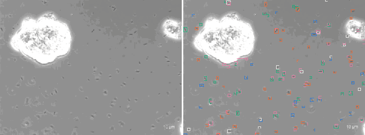
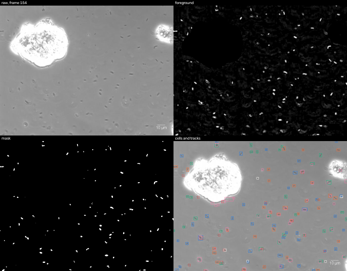
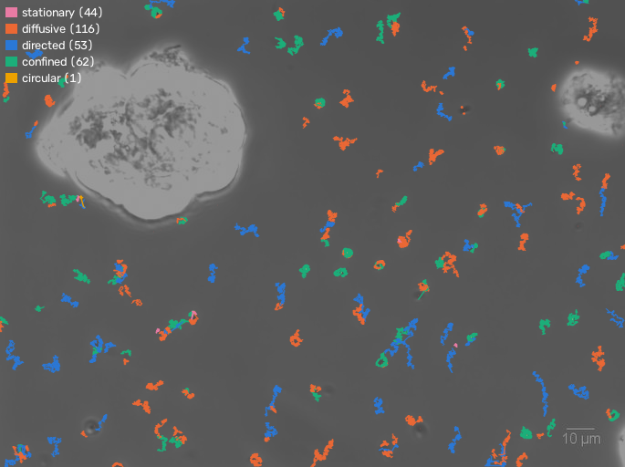
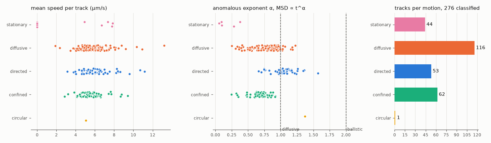

# Video 342910

**Why this configuration**: the configuration calibrated on 342843, rods
measured in pixels, still cells found in the median; 0.333 µm per pixel: 10 µm
bar of 26 to 30 px

| Measure | Value |
| --- | --- |
| frames | 310 |
| detections per frame | 103 (10 % 99, 90 % 108) |
| tracks | 545, 276 classified |
| observations per track | 21 (10 % 1, 90 % 310) |
| motions | 44 stationary, 116 diffusive, 53 directed, 62 confined, 1 circular, 269 undetermined |
| speed (µm/s) | 5.43 (10 % 0, 90 % 7.48) |
| anomalous exponent α | 0.808 (10 % 0.488, 90 % 1.08) |
| diffusion (µm²/s) | 0.309 (10 % 0.146, 90 % 0.628) |

| Hypothesis | Tracks tested | Null rejected | Share |
| --- | ---: | ---: | ---: |
| anomalous | 241 | 73 | 30% |
| persistent | 14 | 0 | 0% |
| chiral | 14 | 0 | 0% |
| non-gaussian | 237 | 78 | 33% |
| periodic | 260 | 0 | 0% |
| confined | 241 | 53 | 22% |

No hint: the numbers look sane.

The 25 longest classified tracks:

| Track | Length | Motion | Confidence | α | Speed (µm/s) |
| --- | --- | --- | --- | --- | --- |
| 19 | 310 | diffusive | 0.56 | 0.92 [0.91, 0.94] | 5.44 |
| 21 | 310 | directed | 1.00 | 1.13 [1.10, 1.16] | 4.03 |
| 32 | 310 | directed | 0.95 | 1.05 [1.04, 1.06] | 5.17 |
| 35 | 310 | diffusive | 0.59 | 0.87 [0.86, 0.89] | 4.98 |
| 38 | 310 | directed | 0.80 | 1.02 [1.01, 1.04] | 5.5 |
| 44 | 310 | diffusive | 0.59 | 0.94 [0.92, 0.97] | 5.03 |
| 47 | 310 | directed | 1.00 | 1.08 [1.05, 1.11] | 4.71 |
| 51 | 310 | confined | 1.00 | 0.76 [0.75, 0.77] | 5.78 |
| 54 | 310 | directed | 1.00 | 1.05 [1.02, 1.07] | 6.03 |
| 57 | 310 | directed | 0.43 | 1.01 [0.99, 1.03] | 4.63 |
| 65 | 310 | confined | 0.98 | 0.82 [0.80, 0.85] | 4.93 |
| 67 | 310 | diffusive | 0.57 | 0.98 [0.96, 1.00] | 4.76 |
| 69 | 310 | directed | 0.99 | 1.05 [1.02, 1.07] | 4.63 |
| 72 | 310 | directed | 1.00 | 1.09 [1.07, 1.11] | 4.89 |
| 76 | 310 | diffusive | 0.59 | 0.96 [0.95, 0.98] | 5.39 |
| 77 | 310 | directed | 0.97 | 1.04 [1.02, 1.06] | 5.41 |
| 78 | 310 | diffusive | 0.49 | 0.96 [0.93, 1.00] | 6.03 |
| 80 | 310 | directed | 1.00 | 1.09 [1.07, 1.10] | 5.08 |
| 81 | 310 | directed | 0.86 | 0.99 [0.97, 1.00] | 5.5 |
| 83 | 310 | diffusive | 0.59 | 0.93 [0.92, 0.95] | 5.42 |
| 95 | 310 | directed | 0.99 | 1.04 [1.02, 1.06] | 6.17 |
| 506 | 310 | stationary | 1.00 | none | 0 |
| 507 | 310 | stationary | 1.00 | none | 0 |
| 508 | 310 | stationary | 1.00 | none | 0 |
| 509 | 310 | stationary | 1.00 | none | 0 |

The configuration is `configuration.toml`; the tracks, `tracks.csv`; every
verdict, `verdicts.csv`.
