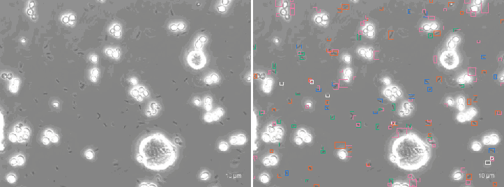
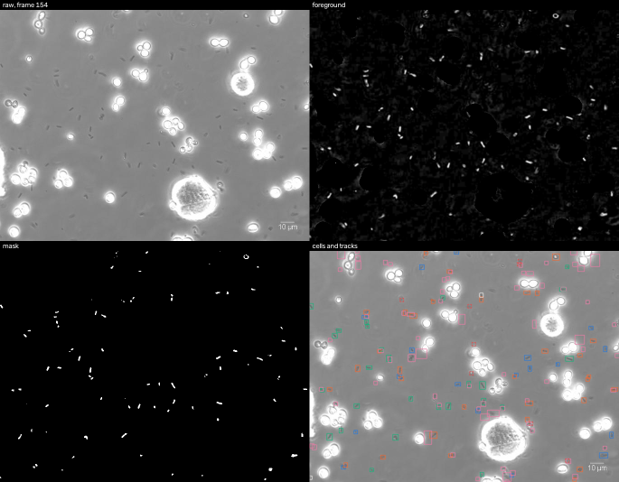
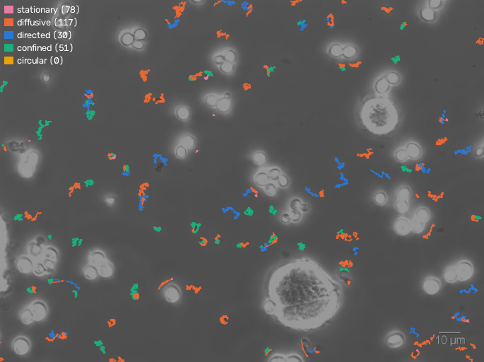
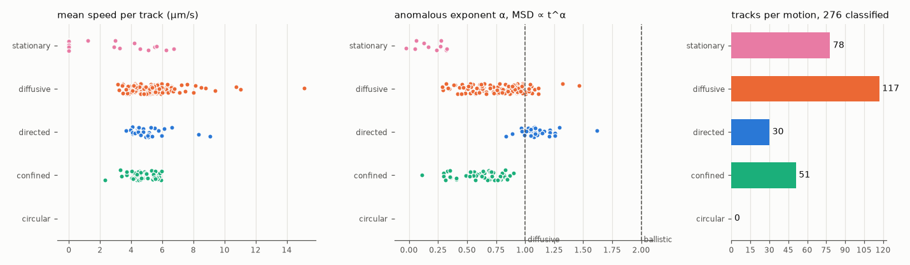

# Video 342998

**Why this configuration**: the configuration calibrated on 342843, rods
measured in pixels, still cells found in the median; 0.333 µm per pixel: the bar
is under a halo: the same microscope and frame size as its 17 fps neighbours

| Measure | Value |
| --- | --- |
| frames | 310 |
| detections per frame | 82 (10 % 76, 90 % 90) |
| tracks | 580, 276 classified |
| observations per track | 16 (10 % 1, 90 % 310) |
| motions | 78 stationary, 117 diffusive, 30 directed, 51 confined, 304 undetermined |
| speed (µm/s) | 4.51 (10 % 0, 90 % 6.15) |
| anomalous exponent α | 0.792 (10 % 0.347, 90 % 1.08) |
| diffusion (µm²/s) | 0.31 (10 % 0.136, 90 % 0.647) |

| Hypothesis | Tracks tested | Null rejected | Share |
| --- | ---: | ---: | ---: |
| anomalous | 235 | 101 | 43% |
| persistent | 4 | 0 | 0% |
| chiral | 4 | 0 | 0% |
| non-gaussian | 209 | 82 | 39% |
| periodic | 259 | 0 | 0% |
| confined | 235 | 81 | 34% |

No hint: the numbers look sane.

The 25 longest classified tracks:

| Track | Length | Motion | Confidence | α | Speed (µm/s) |
| --- | --- | --- | --- | --- | --- |
| 16 | 310 | confined | 1.00 | 0.81 [0.79, 0.83] | 4.12 |
| 19 | 310 | diffusive | 0.58 | 0.81 [0.79, 0.83] | 5.45 |
| 25 | 310 | diffusive | 0.54 | 0.89 [0.88, 0.91] | 4.67 |
| 28 | 310 | directed | 0.94 | 1.06 [1.03, 1.10] | 4.48 |
| 32 | 310 | directed | 1.00 | 1.09 [1.08, 1.10] | 3.97 |
| 34 | 310 | directed | 1.00 | 1.12 [1.10, 1.15] | 4.42 |
| 37 | 310 | directed | 1.00 | 1.16 [1.14, 1.19] | 4.07 |
| 39 | 310 | confined | 0.97 | 0.85 [0.84, 0.86] | 4.53 |
| 49 | 310 | diffusive | 0.59 | 0.98 [0.97, 0.98] | 4.67 |
| 50 | 310 | confined | 0.51 | 0.87 [0.86, 0.88] | 4.43 |
| 53 | 310 | directed | 1.00 | 1.22 [1.18, 1.25] | 4.45 |
| 513 | 310 | stationary | 1.00 | none | 0 |
| 514 | 310 | stationary | 1.00 | none | 0 |
| 515 | 310 | stationary | 1.00 | none | 0 |
| 516 | 310 | stationary | 1.00 | none | 0 |
| 517 | 310 | stationary | 1.00 | none | 0 |
| 518 | 310 | stationary | 1.00 | none | 0 |
| 519 | 310 | stationary | 1.00 | none | 0 |
| 520 | 310 | stationary | 1.00 | none | 0 |
| 521 | 310 | stationary | 1.00 | none | 0 |
| 522 | 310 | stationary | 1.00 | none | 0 |
| 523 | 310 | stationary | 1.00 | none | 0 |
| 524 | 310 | stationary | 1.00 | none | 0 |
| 525 | 310 | stationary | 1.00 | none | 0 |
| 526 | 310 | stationary | 1.00 | none | 0 |

The configuration is `configuration.toml`; the tracks, `tracks.csv`; every
verdict, `verdicts.csv`.
