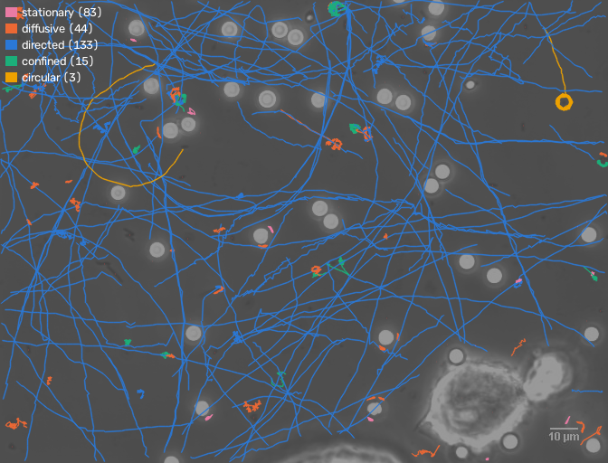
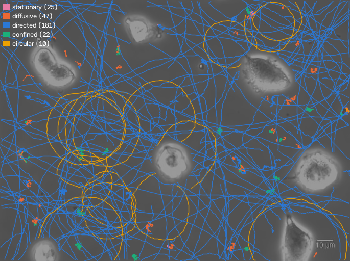
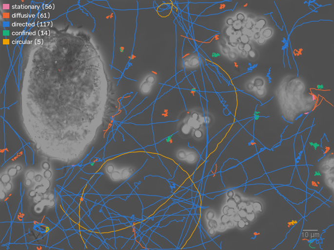
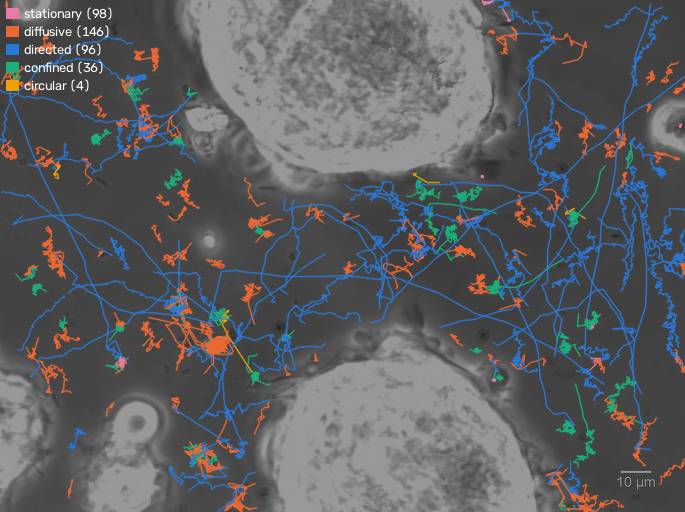
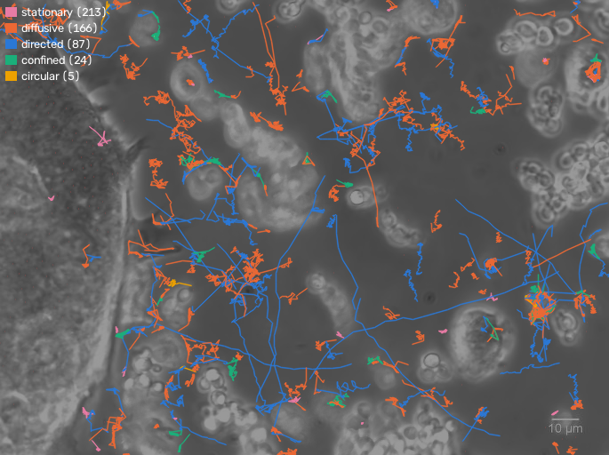
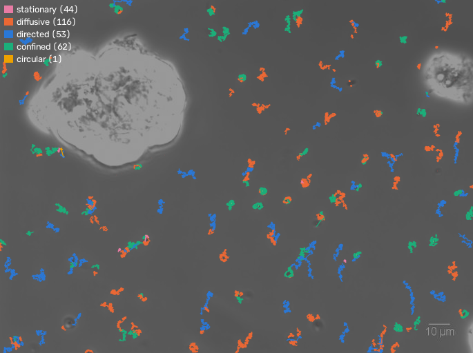
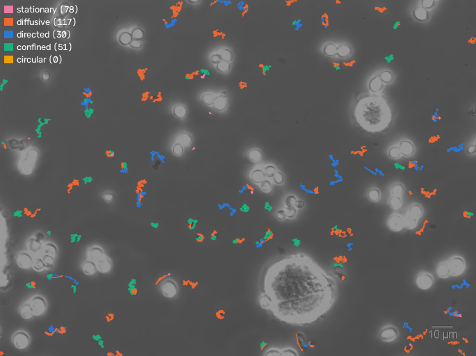
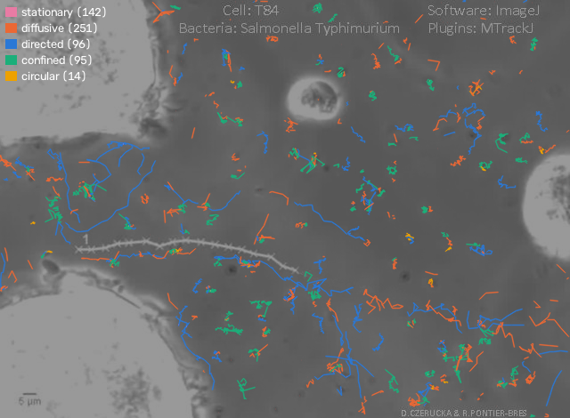
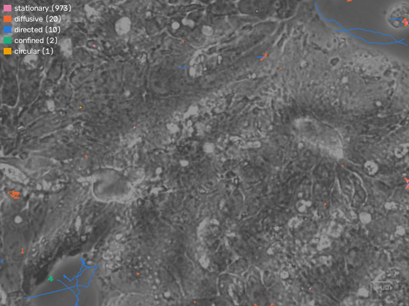

# The study's nine videos

Every video of the 2025 study, run with its own scale and the configuration
calibrated on 342843: a first pass, before the review of each video.

| Video | Tracks | Classified | Motions | Hypotheses rejected |
| --- | ---: | ---: | --- | --- |
| [342843](342843/README.md) | 883 | 278 | 83 stationary, 44 diffusive, 133 directed, 15 confined, 3 circular | anomalous 148/189, persistent 80/88, chiral 12/88, non-gaussian 60/204, tumbling 15/80, periodic 0/234, confined 77/189 |
| [342737](342737/README.md) | 563 | 285 | 25 stationary, 47 diffusive, 181 directed, 22 confined, 10 circular | anomalous 168/218, persistent 149/150, chiral 22/150, non-gaussian 114/264, tumbling 26/149, periodic 0/248, confined 28/218 |
| [342783](342783/README.md) | 598 | 253 | 56 stationary, 61 diffusive, 117 directed, 14 confined, 5 circular | anomalous 129/186, persistent 53/57, chiral 12/57, non-gaussian 80/200, tumbling 8/53, periodic 0/206, confined 57/186 |
| [342517](342517/README.md) | 1738 | 380 | 98 stationary, 146 diffusive, 96 directed, 36 confined, 4 circular | anomalous 145/278, persistent 26/111, chiral 0/111, non-gaussian 129/290, tumbling 7/26, periodic 0/326, confined 95/278 |
| [342580](342580/README.md) | 2731 | 495 | 213 stationary, 166 diffusive, 87 directed, 24 confined, 5 circular | anomalous 221/363, persistent 3/59, chiral 0/59, non-gaussian 161/297, tumbling 0/3, periodic 0/429, confined 194/363 |
| [342910](342910/README.md) | 545 | 276 | 44 stationary, 116 diffusive, 53 directed, 62 confined, 1 circular | anomalous 73/241, persistent 0/14, chiral 0/14, non-gaussian 78/237, periodic 0/260, confined 53/241 |
| [342998](342998/README.md) | 580 | 276 | 78 stationary, 117 diffusive, 30 directed, 51 confined | anomalous 101/235, persistent 0/4, chiral 0/4, non-gaussian 82/209, periodic 0/259, confined 81/235 |
| [342655](342655/README.md) | 1115 | 598 | 142 stationary, 251 diffusive, 96 directed, 95 confined, 14 circular | anomalous 194/484, persistent 6/20, chiral 0/20, non-gaussian 455/455, tumbling 2/6, periodic 77/556, confined 178/484 |
| [342430](342430/README.md) | 1494 | 1006 | 973 stationary, 20 diffusive, 10 directed, 2 confined, 1 circular | anomalous 972/991, persistent 3/3, chiral 0/3, non-gaussian 17/38, tumbling 0/3, periodic 0/998, confined 967/991 |

| | | |
| --- | --- | --- |
|  |  |  |
|  |  |  |
|  |  |  |
