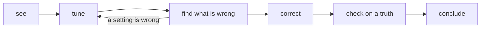

# The agent's tools

What an agent calibrating the pipeline can do, each tool one verb of its
loop. Every command prints JSON and writes pictures the agent opens; the
method that strings them together is the [guide](guide.md).

| Verb | Tools |
| --- | --- |
| See | [probe](#probe), [run](#run), [inspect](#inspect), [gallery](#gallery) |
| Tune | [sweep](#sweep), [mask](#mask) |
| Find what is wrong | [suspects](#suspects), [misses](#misses) |
| Correct | [correct](#correct) |
| Check on a truth | [synth](#synth), [bench](#bench), [search](#search) |
| Conclude | [stats](#stats), [history](#history) |

## See

### probe

Measures a video before any setting: noise, polarity, the contrast and size
of what moves, the share that never moves; proposes the burnt-in scale bars
with a crop of each, and a first configuration.

- **Reads**: a video, a TIFF stack or a folder of images.
- **Writes**: `probe.png` (a frame, the median background, what moves, the
  spread over time), `appearance.json`, `suggested.toml`, `scale_bar_*.png`.
- **Cannot**: know what is being looked for. On the study's video it called
  the cells bright, because the halos of beads jitter more than the dark rods
  swim: the agent corrects it by looking at the motion map.

### run

Runs a configuration on a video and lays the run out as a folder.

- **Writes**: four-view looks of chosen frames (raw, foreground, mask, cells
  and tracks), `tracks.gif` (the video as filmed beside the marked one),
  the trajectory map, the distributions, `tracks.csv`, `verdicts.csv`,
  `evidence.csv`, `summary.json` with hints, `report.md`.
- **Marks**: a box per cell in its verdict's colour, a translucent tail, red
  corners for a track the tracker is waiting for.

### inspect

Films chosen tracks up close: a camera that follows them over their life,
every track in view numbered. For judging a swap, a merge, a false cell.

### gallery

One small view per track of one verdict, many at once: a hundred cells
judged in one picture. Found the still rods a median background had erased.

## Tune

### sweep

One parameter over several values on the same clip and the same view, side
by side, with the tracks and the misses of each. Showed that no threshold
caught the diagonal rods: the area filter was the cause.

### mask

**[question]** Not built yet. The large static objects (beads, host cells,
debris, burnt-in text) are excluded today by a level on the median
background, invisibly. A mask the agent can see, grow by hand and keep in
the configuration would remove them from every test.

## Find what is wrong

### suspects

Ranks what may be wrong in a run: a step far longer than the track's usual
(an identity swap), a track that starts where another ended (a broken
track), an unsure verdict, a speed far from the others; draws each up close.

### misses

A looser detection, tracked the same way, keeps what moves where no kept
track goes: the cells the pipeline missed. Still things are left out, they
are halos and edges.

## Correct

### correct

Records a judgement on one or more tracks, with its reason and its author,
in the run's `corrections.toml`, then replays the run with every judgement
applied: **split** a track at a frame, **join** two, **drop** one,
**label** its motion, **force** the cell a looser detection follows through
a point. Each correction is an annotation.

## Check on a truth

### synth

Renders a synthetic video with every position known: from a scene file, or
as the twin of a probed video, its appearance measured and its population
chosen by the agent.

### bench

Scores a configuration on synthetic scenes: MOTA, precision, recall,
identity switches for the tracks; the share of right verdicts.

### search

The baseline an agent must beat: random draws of the parameters, blind or
around a start, with the truth as their score and the same budget.

## Conclude

### stats

Compares populations across runs: the motile share, the swimmers' speeds,
the circling cells' sense with a binomial test, the rate of sharp turns, the
distances to static objects.

### history

The journal of a video's runs, each with the reason it was made.
