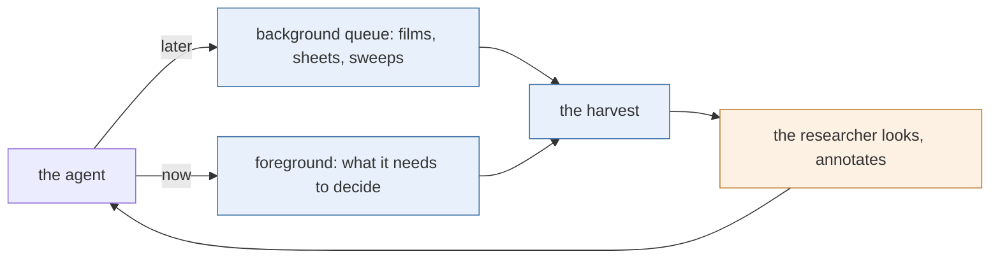

# Assisted research, a permanent process

**[defined]** 2026-11-14, by the author and the agent. Research assisted by an
agent is not a request and an answer: it runs all the time, and the
researcher always has something to look at and something to steer.

## Two lanes for the machine

- **The foreground** is what the agent waits on: a probe, a run whose numbers
  decide the next step. It runs at once, at full priority.
- **The background** is what the researcher will want to see but nobody waits
  on: a film of every case, a gallery, a sweep. The agent stacks it with a
  priority and goes on; a worker runs it niced, so the foreground stays fast.

`just agent::queue 5 <command>` stacks, `just agent::worker` drains,
`just agent::harvest` says what came back. The agent starts the worker in the
background and is told when it ends: it knows what it gathered, and links it.

## What the researcher needs

- **Something to see at any moment**: the harvest lands in the documents as
  films and figures, not in a terminal that scrolled away.
- **A way to steer without stopping the agent**: today, a message in the
  session. **[question]** Annotating the documents themselves, see the
  [frictions](frictions.md#open).

Back: [the map](README.md).
