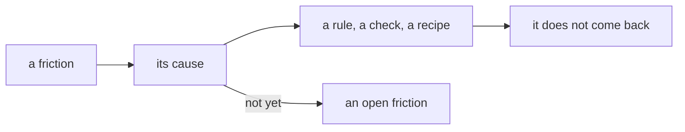

# Frictions

**[fact]** Kept since 2026-11-14. A friction is a moment the work slowed: for
the reader of the agent's work, or for the agent doing it. Each is written
with its cause and what it led to, so it does not come back. This is the
input of the [self-improving loop](metaphilosophy.md).

## The reader's

What slowed the author reading the work.

| Friction | Cause | What it led to |
| --- | --- | --- |
| The README told nothing until the end | docs treated as a last step | [top-down](../.agents/rules/top-down.md): the top first |
| Concept names that could not be clicked | tables written as text | [doc-shape](../.agents/checks/doc-shape.sh) notes unlinked names |
| A concept to imagine without a picture | figures made last, if at all | doc-shape asks a picture of each model concept |
| One file holding many concepts | files grown instead of split | a folder per concept, one file each |
| Boxes that blinked in the films | a lost track drawn only when observed | red corners while the tracker waits |
| Tails hiding the cells | opaque marks, drawn before the downscale | translucent tails, drawn at the output scale |
| Cells plainly there, not tracked | no tool to see what was missed | `mcv misses`, `mcv correct ... force` |
| One video studied over and over | no source beyond the study | the [catalogue](../catalogue/README.md) and `mcv fetch` |
| A huge diagram for little | the drawing rules not read | the markdown rule's mermaid section, read first |

## The agent's

What slowed the agent while it worked, found in its own session.

| Friction | Cause | What it led to |
| --- | --- | --- |
| A scripted edit that silently did nothing | a replace whose anchor the formatter had rewrapped | `just agent::edit`, which fails when the anchor is absent |
| A result believed before it was looked at | numbers read without their picture | **[question]** a hint when the detections per frame spread too wide |
| A test called broken when its truth was | the synthetic run-and-reverse had no rhythm | look at one track before blaming the test |
| A gate thought red | `a && b; echo $?` printed `a`'s status | run the gate alone, read its own status |
| A mask that hid the cells | a level on a frame lit unevenly | polygons: `inside`, `ignore_regions` |
| Thousands of false cells in a few frames | a camera's automatic exposure | `even_exposure`, and the probe measures the jumps |
| Still cells absent from every count | a median background erases them | still cells found in the median |
| Diagonal rods dropped | areas measured as bounding boxes | areas in pixels |
| The same throwaway line typed again | no place for the agent's own tools | the `self` group of [agent.just](../agent.just) |

## Open

- **[question]** A result whose spread is wild (2 detections per frame in the
  median, 240 at the 90th percentile) should stop the agent before it reads
  the means: a hint in the summary, or a check of the run.
- **[question]** Videos of one condition filmed in different places differ in
  more than the condition: a comparison needs fields alike, or many of them.

Back: [the map](README.md).
