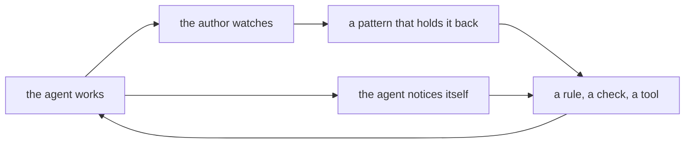

# Metaphilosophy

**[defined]** 2026-11-14, by the author. Why this repository looks the way
it does: not only a motility toolkit, but an experiment in how an agent does
research.

## The observation

Some of what makes research work does not live in a model's weights. An agent
left alone codes before it understands, writes details before the plan,
trusts a picture over a measure, calls a test done before checking it on a
truth. These are not gaps in knowledge: they are habits of method, and the
same ones come back from one project to the next.

The author's part is to **watch the work as it grows**, the way one monitors
a system, and to catch those patterns by hand.

## The bet

What the author catches is turned into something explicit the agent keeps: a
rule, a check, a recipe, a tool. Large labs hope such method emerges from
gradient descent on bigger models; the bet here is that much of it is a
structure of computational thinking any engineer recognises, and that it can
be written down.

**The aim is that the agent improves itself.** Not only keeping what it is
shown, but catching its own patterns: the command it types for the third time
becomes a recipe, the mistake it makes twice becomes a check, the document it
cannot read at a glance becomes a figure. The author's loop is the scaffold;
the agent's own loop is the point.

## The agent's own toolbox

[agent.just](../agent.just) is where the second loop lands. Its recipes are
not the user's commands: they are the agent's meta-library, grown by the agent
from what it caught itself doing again and again. When a line comes back in a
session, it becomes a recipe; when a recipe goes unused, it goes. `just
--list agent` shows what the agent has taught itself so far.

## What it looks like here

Each tool is small, informal and made by the agent for itself. Some of this
repository's:

| A pattern caught | What the agent keeps now |
| --- | --- |
| details written before the plan | [top-down](../.agents/rules/top-down.md): the link and an empty placeholder first |
| a sub-problem forgotten once started | planned `just` recipes that fail with "not built yet" |
| code before the problem is understood | [the model](model/README.md) before any test |
| a test trusted because it looked right | [`mcv validate`](../docs/tools.md#validate): every test's false positives and power |
| a picture trusted over a measure | the [review tools](../docs/tools.md): suspects, misses, galleries, sweeps |
| a doc too long, too dense, unlinked | [doc-shape](../.agents/checks/doc-shape.sh), run on every commit |
| the same throwaway line typed again and again | a recipe in [agent.just](../agent.just), made by the agent itself |

## Why it may go far

- **Explicit beats emergent where it can**: a written rule can be read,
  argued, corrected and shared; a habit in weights cannot.
- **Small tools compound**: each one removes a class of mistakes for good, and
  the next problem starts from there.
- **The same loop serves any field**: the patterns caught here (formalise
  first, measure against a truth, keep each document one concept) were caught
  in the author's other projects first.

This is not a claim about general intelligence. It is a claim about
efficiency: research and engineering done with fewer wasted turns, by an
agent that keeps the method it is shown.

Back: [the map](README.md).
