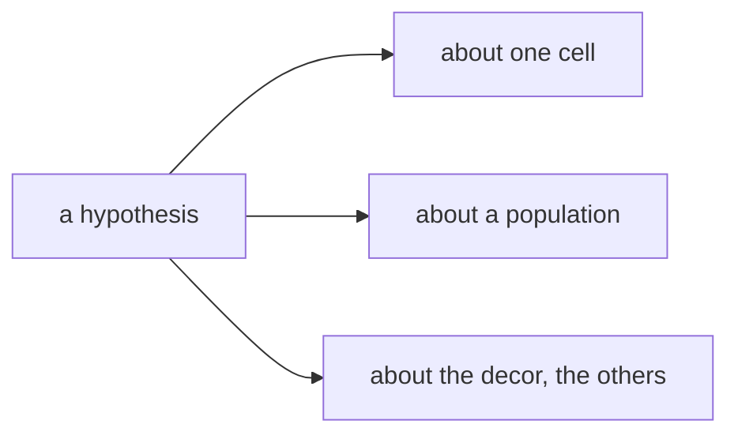

# The hypotheses

**[sketch]** 2026-11-14. A hypothesis is a pair of [models](models.md), one
nested in the other: a null $H_0$, an alternative $H_1$ that adds one
ingredient, a statistic, and its distribution under $H_0$. A test is trusted
only once it is checked on synthetic cells seen through the
[observation chain](trajectory.md).

## Three levels

## About one cell

| Hypothesis | $H_0$ | $H_1$ | Statistic | Status |
| --- | --- | --- | --- | --- |
| Moves | still, jitter only | Brownian | MSD slope against the noise floor | model weight |
| Anomalous | Brownian, $\alpha = 1$ | power law in $t^\alpha$ | likelihood ratio, both laws with a noise offset, $\chi^2_1$ | **[fact]** 1 % false positives, power 100 % on swimmers, **0 % on fBm** |
| Persistent | Brownian | active swimmer | mean $\cos$ of turns $> 0$, t-test | **[fact]** 0 % false, 100 % power |
| Chiral | swimmer | chiral swimmer | mean signed turn $\neq 0$, t-test | **[fact]** 0 % false, 100 % power |
| Tumbling | swimmer, turns from rotational diffusion | run-and-tumble | sharp turns beyond a Gaussian of their robust spread, binomial | **[fact]** 0 % false, 91 % power |
| Rhythmic | tumbles at random times | run-and-reverse | periodogram peak of turn sizes against shuffles | **[fact]** fails: 0 % power |
| Confined | Brownian | Ornstein-Uhlenbeck | Akaike weight of a saturating MSD | **[fact]** 2 % false, 77 % power |
| Heavy tails | Gaussian steps | CTRW, Lévy | Shapiro-Wilk on standardised steps | **[fact]** 95 % power on CTRW |
| Body-frame | isotropic kicks | body-frame Brownian | variance of steps along over across the axis, F-test | **[question]** needs the axis |
| Gait | no body wave | travelling wave | phase velocity of curvature along the body | **[question]** needs the skeleton |

The figures are rejection rates at $q < 0.05$, a hundred synthetic tracks
of each behaviour, 100 frames, localisation noise 0.3 px.

**Why two fail.** Fractional Brownian motion at $\alpha = 0.6$ over 100
frames bends the MSD less than the noise offset does: the test cannot tell
them apart at this length **[sketch]**. The rhythm of run-and-reverse is
blurred because a reversal turns by $\pm\pi$ at a random sign, and because
each run's length varies; a test on the intervals between sharp turns, not
on their spectrum, is the next try **[sketch]**.

## About a population

| Hypothesis | $H_0$ | $H_1$ | Statistic | Status |
| --- | --- | --- | --- | --- |
| Two kinds | one law of speeds | a mixture of two | BIC of one Gaussian against two, on log speed | **[question]** |
| Heterogeneous | one diffusion coefficient | one per cell | spread of the cells' $D$ against the spread their track lengths allow | **[question]** |
| Chirality bias | each sense equally likely | one sense preferred | binomial on the circling tracks' senses | **[fact]** implemented in `mcv stats` |
| Ergodic | time averages equal the ensemble's | they do not | ergodicity breaking parameter of the MSD | **[question]** |

## About the decor and the others

Each tested against [surrogates](population.md): the same tracks, shifted or
moved, which keep every cell's law and break the relation under test.

| Hypothesis | $H_0$ | $H_1$ | Statistic |
| --- | --- | --- | --- |
| Trapped near objects | the decor does not change the law | swimmers linger near objects | time spent within $r$ of an object |
| Slowed near objects | speed independent of the distance | slower close | slope of speed against distance |
| Steered along edges | heading independent of the edge | parallel to it | mean $\lvert \cos \rvert$ of heading to the edge's tangent |
| Aligned with neighbours | headings independent | aligned within $r$ | polar order of neighbours' headings |
| Avoiding or gathering | positions independent | repelled or attracted | pair correlation $g(r)$ |
| One kind drives another | kinds independent | one follows or flees | cross pair correlation over time lags |

**[question]** None of these is implemented yet. The study's videos hold a
natural case: Salmonella near host cells, where the 2012 paper describes
near-surface swimming that leads to the sites of invasion **[to check]**.

## What a result says

- A test **rejects a null**; it never proves the alternative. A swimmer that
  rejects "Brownian" is "not Brownian", and the model selection says which
  alternative fits best.
- Hundreds of tracks make hundreds of tests: the rate of false discoveries
  is held at 5 % by Benjamini-Hochberg, per hypothesis and per run.
- Short tracks have little power: a hypothesis not rejected on a track of 20
  frames is untested, not refuted.

Back: [the models](models.md).
