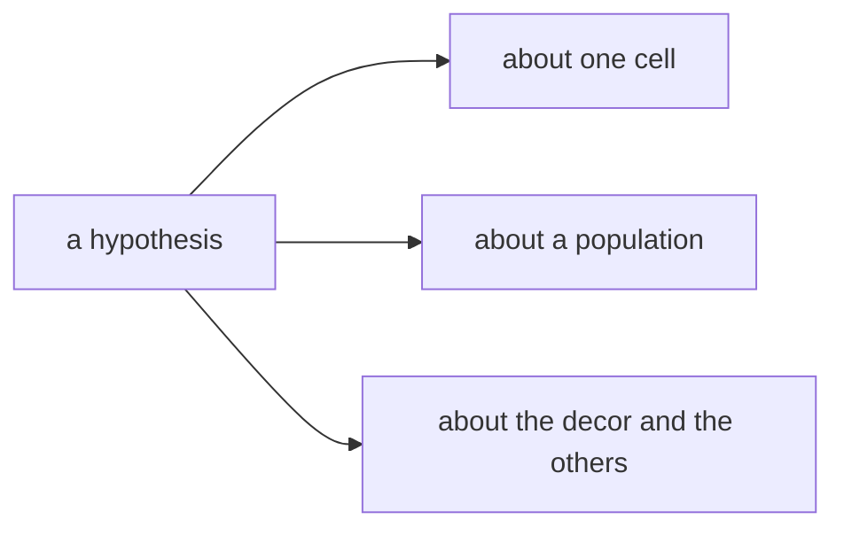

# The hypotheses

A hypothesis is a pair of [models](../models.md), one nested in the other: a
null $H_0$, an alternative $H_1$ that adds one ingredient, a statistic, and
its distribution under $H_0$. A test is trusted only once it is checked on
synthetic cells seen through the [observation chain](../trajectory.md#what-the-video-shows).

1. [About one cell](one-cell/README.md): [moves](one-cell/moves.md),
   [anomalous](one-cell/anomalous.md), [persistent](one-cell/persistent.md),
   [chiral](one-cell/chiral.md), [tumbling](one-cell/tumbling.md),
   [rhythmic](one-cell/rhythmic.md), [confined](one-cell/confined.md),
   [heavy tails](one-cell/heavy-tails.md), [body-frame](one-cell/body-frame.md),
   [gait](one-cell/gait.md).
2. [About a population](population.md): two kinds, heterogeneity, a chirality
   bias, ergodicity.
3. [About the decor and the others](context.md): trapped, slowed, steered,
   aligned, gathering, driven.

## What a result says

- A test **rejects a null**; it never proves the alternative. A swimmer that
  rejects "Brownian" is "not Brownian", and the model selection says which
  alternative fits best.
- Hundreds of tracks make hundreds of tests: the rate of false discoveries is
  held at 5 % by Benjamini-Hochberg, per hypothesis and per run.
- Short tracks have little power: a hypothesis not rejected on a track of 20
  frames is untested, not refuted.

Back: [the model](../README.md).
