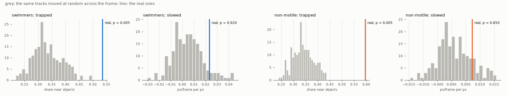

# Hypotheses about the decor and the others

A cell's law may depend on where it is and on who is near. Every test here
compares the real tracks with [surrogates](../population.md#surrogates-the-null-of-an-interaction):
the same tracks shifted or moved, which keep each cell's law and break the
relation under test. **[fact]** 2026-11-14: [trapped](#trapped) and
[slowed](#slowed) are built, `mcv interactions`; the others are not.

| Hypothesis | Question | Statistic |
| --- | --- | --- |
| [Trapped](#trapped) | do swimmers linger near objects? | time within $r$ of an object |
| [Slowed](#slowed) | do cells slow down near objects? | slope of speed against distance |
| [Steered](#steered) | do cells follow the edges? | mean $\lvert\cos\rvert$ of heading to the edge |
| [Aligned](#aligned) | do neighbours swim the same way? | polar order within $r$ |
| [Gathering](#gathering) | are cells attracted or repelled? | pair correlation $g(r)$ |
| [Driven](#driven) | does one kind follow or flee another? | cross correlation over time lags |

The laws behind them are drawn in [interactions](../interactions.md).

## Trapped

**[fact]** Checked on a truth: swimmers among obstacles, following their edges
or bouncing off them; 100 % power, no false positive. The first surrogates
were forbidden to cross an object and kept far from them: they called mere
bouncing a trap 40 % of the time. They may cross now, and only the positions
outside the objects count.

**[fact]** 2026-11-14, five videos of the study, radius 10 px:

| Video | Swimmers near objects | Surrogates | p | Non-motile near objects | p |
| --- | ---: | ---: | ---: | ---: | ---: |
| 342843, beads | 0.11 | 0.13 | 0.85 | 0.12 | 0.49 |
| 342737 | 0.08 | 0.07 | 0.29 | 0.03 | 0.92 |
| 342517, host cells | 0.13 | 0.13 | 0.47 | 0.14 | 0.37 |
| 342580, host cells | **0.54** | 0.33 | **0.005** | **0.60** | **0.005** |
| 342910, host cells | 0.02 | 0.04 | 0.74 | 0.05 | 0.28 |

**[caution]** Only 342580 rejects, and for swimmers and non-motile cells
alike: adhesion of every cell to the host cells, or fragments of the hosts'
halos counted as cells. Not believed before a gallery of those tracks.

Swimmers near a surface turn in circles and stay; the study's paper links
this near-surface swimming to the sites where Salmonella invades host cells
**[to check]**. The time the real swimmers spend within $r$ of the host
cells, against the same tracks moved across the frame.

## Slowed

The speed of each observation against its distance to the nearest object; the
slope, against the slopes of moved tracks.

## Steered

Near an edge, the heading against the edge's tangent: parallel swimming gives
a mean $\lvert\cos\rvert$ near one, random headings near $2/\pi$.

## Aligned

The polar order of the headings of the cells within $r$ of each other, against
the same tracks shifted in time.

## Gathering

The pair correlation $g(r)$ of the positions: above one at short range is
attraction, below one is avoidance; the null shifts tracks in time.

## Driven

For two kinds, the correlation between one's velocity and the direction to
the other, at a time lag: a positive peak at a positive lag is a chase.

Back: [the hypotheses](README.md).
