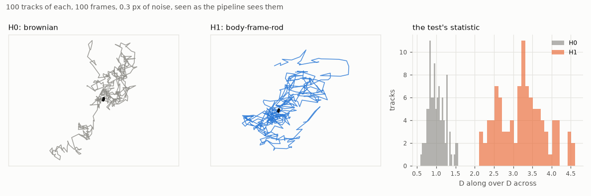

# Body-frame

**Question**: Are the kicks larger along the body than across it?

| | |
| --- | --- |
| $H_0$ | isotropic kicks |
| $H_1$ | [body-frame Brownian](../../models.md#passive), or a swimmer moving along its axis |

## The test

Each one-frame step is projected on the body's long axis, measured from the
shape at the step's start. Under isotropic kicks the mean squares along and
across are equal; their ratio, $D_\parallel / D_\perp$ for a passive rod, is
F-distributed. Run only on tracks whose median elongation is at least 1.4.

The axis comes from the [shape](../../representation.md), the step from the
centres: the test does not measure itself.

## Checked on a truth

**[fact]** 2026-11-14: 100 % power on a passive rod with
$D_\parallel = 4 D_\perp$; 0 % false positives on Brownian, confined and
fractional cells; **20 % on waiting times**, whose zero steps make the ratio
unstable.

## On the study's video

**[fact]** 2026-11-14, `342843`, the whole video:

| Cells | Tracks | Median $D_\parallel / D_\perp$ | Isotropy rejected |
| --- | ---: | ---: | ---: |
| Swimmers | 120 | 10.9 | 113 |
| Non-motile, diffusing | 41 | 2.7 (quartiles 1.4 to 5.5) | 26 |
| Confined | 12 | 2.0 | 8 |

- **Swimmers move eleven times more along their axis than across it**: they
  swim along their bodies. It also says the axis measured on rods of a few
  pixels is sound.
- **Non-motile rods diffuse 2.7 times more along their axis**: the
  body-frame Brownian. A slender passive rod is expected near 2
  **[to check]**; the excess may be drift, or slow swimmers classified as
  diffusing **[sketch]**.

## What it misses

Noise pulls the ratio towards 1: a rod with $D_\parallel = 4 D_\perp$ is
measured near 3.3. The study's ratios are underestimates.

A swimmer rejects isotropy too: the test says *anisotropic*, the model
selection says *passive or active*.

Back: [one cell](README.md).
