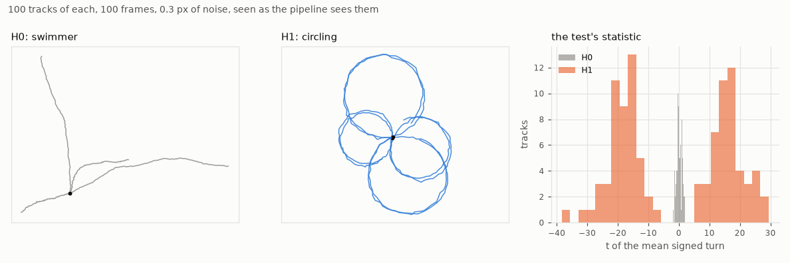

# Chiral

**Question**: Does the cell turn one way more than the other?

| | |
| --- | --- |
| $H_0$ | [active swimmer](../../models.md#active) |
| $H_1$ | [chiral swimmer](../../models.md#active) |

## The test

The mean signed turn against zero, by a t-test.

## Checked on a truth

**[fact]** 0 % false positives, 100 % power on circling cells.

## What it misses

The sense depends on which side of the surface the camera looks from: a
population's bias is a separate test ([population](../population.md)).

Back: [one cell](README.md).
