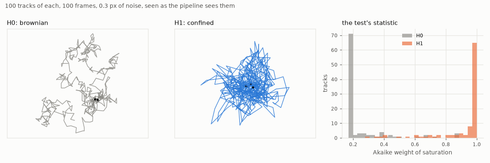

# Confined

**Question**: Is the cell held near a centre?

| | |
| --- | --- |
| $H_0$ | [Brownian](../../models.md#passive) |
| $H_1$ | [confined](../../models.md#passive) |

## The test

The Akaike weight of a saturating MSD against a linear one.

## Checked on a truth

**[fact]** 2 % false positives, 77 % power.

## What it misses

A weight is not a p-value: it is not corrected for the number of tracks.

Back: [one cell](README.md).
