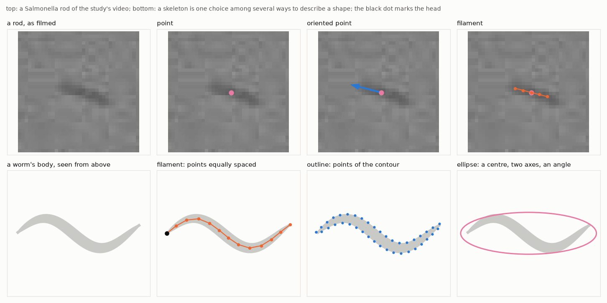

# Gait

**Question**: Does a wave of curvature travel along the body?

| | |
| --- | --- |
| $H_0$ | no body wave |
| $H_1$ | [a travelling wave](../../models.md#the-body-itself) |

## The test

**[sketch]** The phase velocity of the curvature along the
[skeleton](../../representation.md).

## Checked on a truth

**[question]** Not built: it needs the skeleton.

## What it misses

Forward and backward waves are the same test, of opposite signs.

Back: [one cell](README.md).
