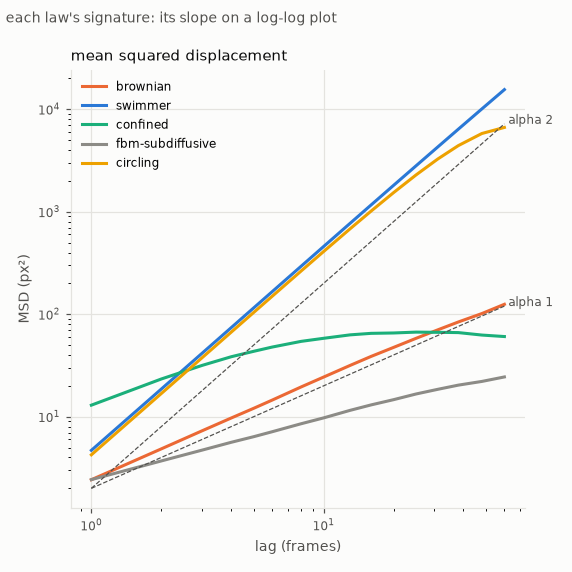

# Moves

**Question**: Does the cell move at all, beyond the noise of its position?

| | |
| --- | --- |
| $H_0$ | still, jitter only |
| $H_1$ | [Brownian](../../models.md#passive) |

## The test

The MSD's growth against the noise floor $4\sigma^2$: a flat MSD is a still
cell.

## Checked on a truth

**[sketch]** Decided today by the model selection, a weight and not a p-value.

## What it misses

A cell that moves less than the noise in the whole track is still for the test.

Back: [one cell](README.md).
