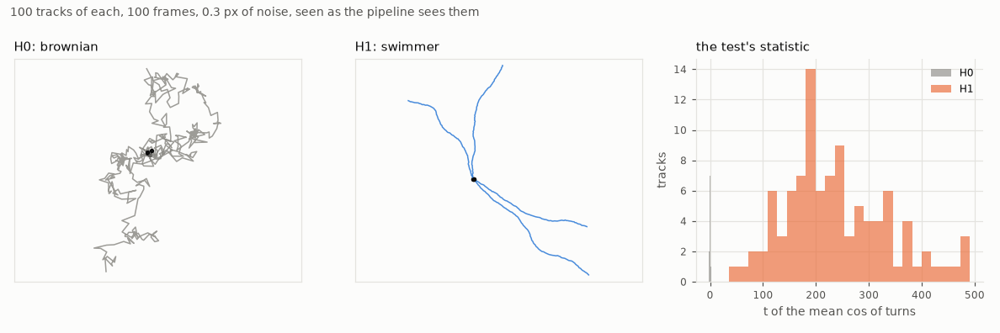

# Persistent

**Question**: Does the cell keep its heading from one step to the next?

| | |
| --- | --- |
| $H_0$ | [Brownian](../../models.md#passive) |
| $H_1$ | [active swimmer](../../models.md#active) |

## The test

The mean cosine of the turns between steps of three frames, above zero, by a
one-sided t-test.

## Checked on a truth

**[fact]** 0 % false positives, 100 % power on swimmers.

## What it misses

Steps of three frames lift the heading above the localisation noise; a slow
cell's heading stays noise.

Back: [one cell](README.md).
