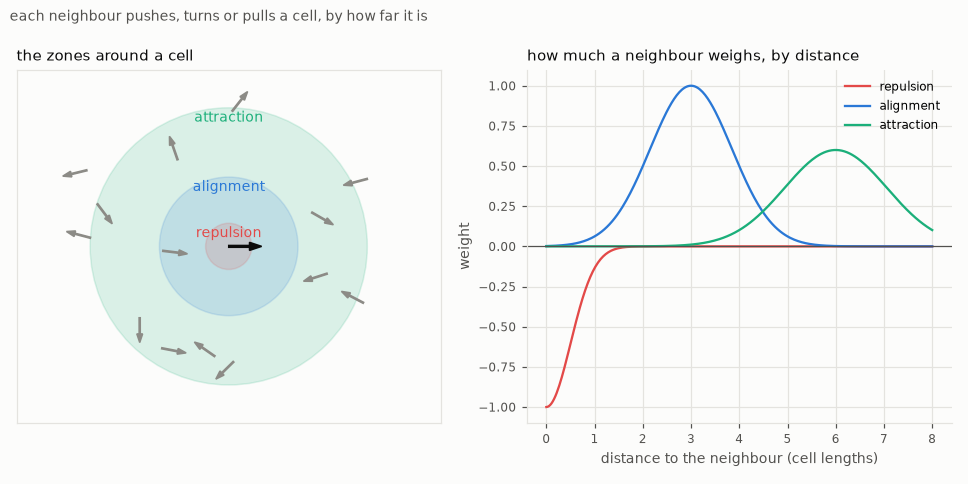
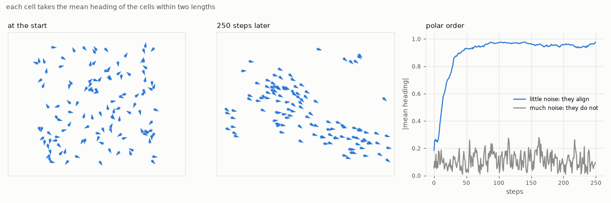
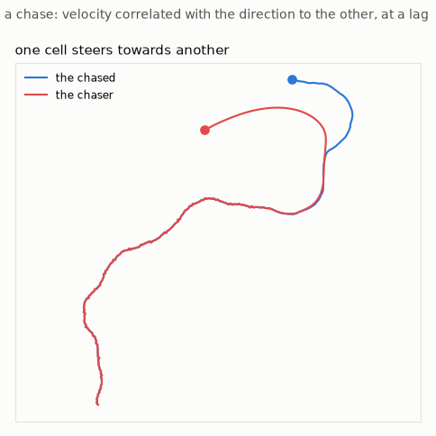
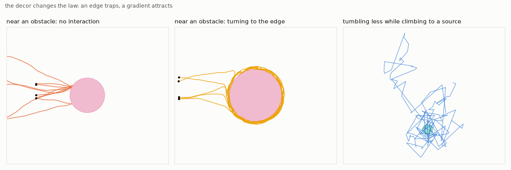

# Basic interactions

**[sketch]** 2026-11-14. The [models](models.md) let each cell move alone.
Here a cell's law depends on what is near: its neighbours, or the decor. Each
interaction is a weight that changes with a distance, and each is the
alternative of one [hypothesis about the context](hypotheses/context.md).

## The neighbourhood

A cell sees the cells within a few lengths of it. A simple and widely used
picture splits that space into zones: too close, it moves away; at middle
range, it takes its neighbours' heading; farther, it is drawn in.

$$
\dot\theta_i =
\sum_{j \neq i} w(\lvert x_j - x_i \rvert)\, f(\theta_i, \theta_j, x_j - x_i)
+ \text{noise}
$$

The kernel $w(r)$ is the whole interaction: its sign, its range, its shape.

## Alignment

Each cell turns towards the mean heading of the cells within $r$. With little
noise a disordered crowd orders itself; with much noise it stays disordered.
The **polar order**, the length of the mean heading, measures it, from 0 to 1.

Tested by [aligned](hypotheses/context.md#aligned): the polar order of real
neighbours against the same tracks shifted in time.

## Attraction and repulsion

A neighbour inside the repulsion zone pushes, one in the attraction zone
pulls. Over many frames this shows in where the cells sit: the **pair
correlation** $g(r)$, the density of neighbours at distance $r$ over its mean,
rises above one where cells gather and falls below where they avoid each
other. Tested by [gathering](hypotheses/context.md#gathering).

## Chasing and fleeing

One cell steers towards another, or away. The chaser's velocity correlates
with the direction to the chased, at a positive lag: it reacts after.

Tested by [driven](hypotheses/context.md#driven), for two kinds of cells.

## The decor

The decor changes the law without being alive:

- **An edge traps**: a swimmer that turns parallel to a surface it meets keeps
  circling it, where one that bounces off leaves. Tested by
  [trapped](hypotheses/context.md#trapped) and
  [steered](hypotheses/context.md#steered).
- **A gradient attracts**: a run-and-tumble cell that tumbles less often while
  it climbs towards a source drifts to it, with no steering at all
  (chemotaxis).

The study's videos hold the natural case: Salmonella near host cells, where
near-surface swimming is reported to lead them to the sites they invade
**[to check]**.

## What the pipeline implements today

**[question]** Nothing yet: these figures are drawn by small simulations in
`scripts/illustrate/`. The tests need these laws in the library's synthetic
scenes, to measure their false positives and power as for the one-cell tests;
the planned recipe is `just interactions`.

Back: [the models](models.md). Next: [internal state](internal-state.md).
