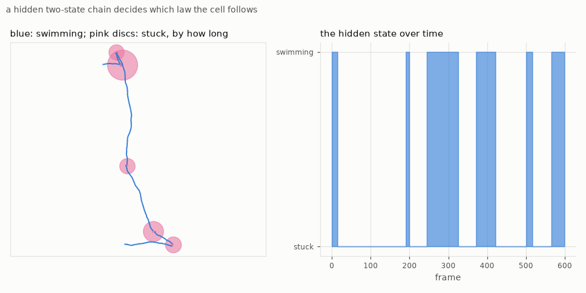
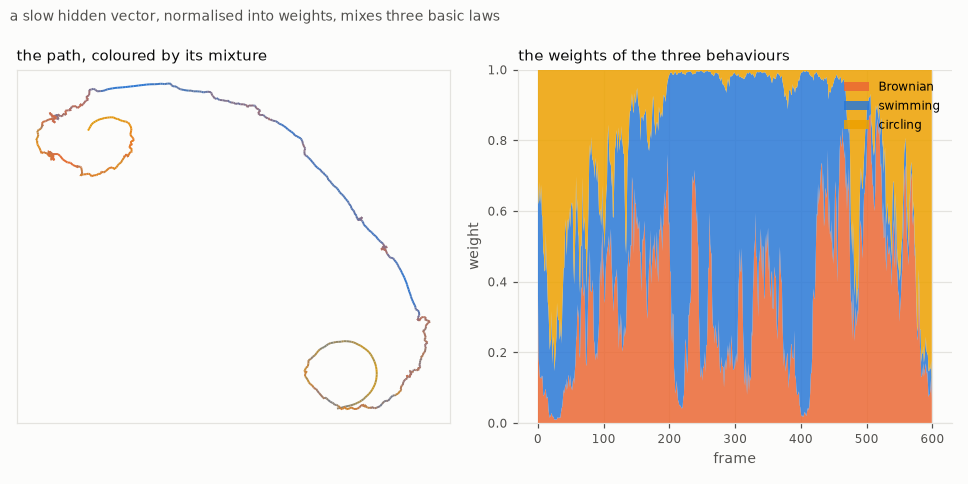

# Internal state

**[sketch]** 2026-11-14. A cell is not a fixed law of motion: inside it, a
state the video does not show (its motors, its energy, what it senses) decides
which law it follows at each moment. The [models](models.md) are what it does
in one state; this file is how it moves between them.

## A state the video does not show

The internal state $z(t)$ is hidden twice: inside the cell, and behind the
[observation chain](trajectory.md#what-the-video-shows). It is read only
through how the path changes.

## A switching state

The simplest internal state takes a few values, and jumps between them at
random: a **hidden Markov chain**. Swimming, then stuck; running, then
tumbling. In each state the cell follows one law; the rates of the jumps set
how long each state lasts.

$$P(z_{t+1} = b \mid z_t = a) = Q_{ab}, \qquad \text{law at } t = \text{law}_{z_t}$$

- [Run-and-tumble](models.md#active) is the case where the second state is a
  short turn.
- The durations in each state are the observable signature: exponential for a
  Markov chain, heavier-tailed when the cell has a memory.

## A continuous state, a mixture of behaviours

A richer state is a vector that drifts slowly. A naive but useful heuristic:
turn it into **normalised weights** over a few basic laws, and let each step
be the weighted mixture of their steps.

$$
w(t) = \operatorname{softmax}(z(t)),
\qquad
\Delta x_t = \sum_k w_k(t)\, \Delta x^{(k)}_t
$$

The cell is then never exactly Brownian nor exactly a swimmer: it slides
between them, and a verdict per track is an average over its states.

## What it changes for the tests

- **One verdict per track is too coarse** for a cell that switches: a track
  should be cut where its law changes, then each piece tested. **[question]**
  A change-point detection on the steps is the planned tool.
- **A population of switching cells looks heterogeneous**: before testing
  [heterogeneity](hypotheses/population.md#heterogeneous) between cells, rule
  out switching within them.
- **The state can depend on the context**: a cell that sticks more often near
  a host cell is an [interaction](interactions.md) through its internal state.

Back: [interactions](interactions.md). Next: [many trajectories](population.md).
