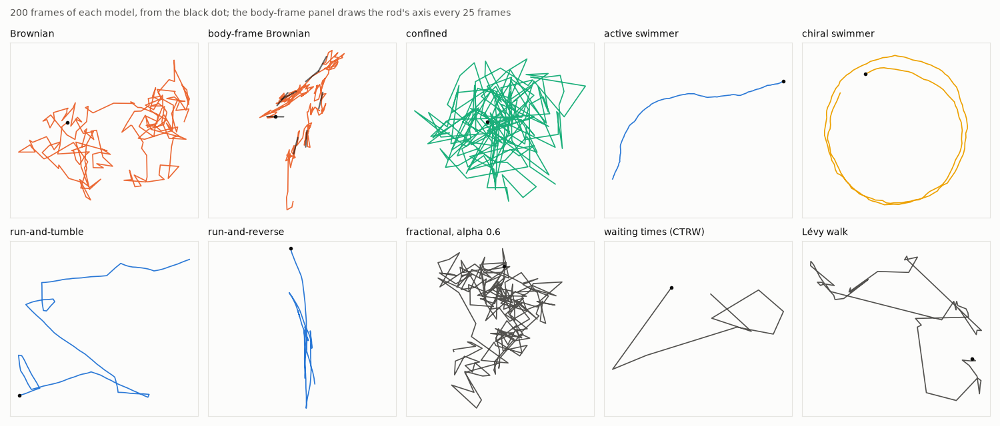
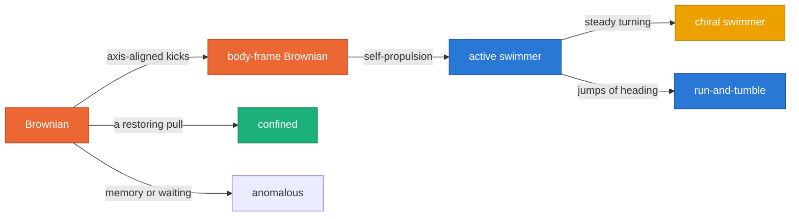

# Basic models

**[sketch]** 2026-11-14. Laws for the hidden state of
[one trajectory](trajectory.md), each a stochastic differential equation.
They nest: each adds one ingredient to a simpler one, which is what makes
them testable against each other ([hypotheses](hypotheses/README.md)).

## How they nest

The colours are the verdicts' in every video and figure.

## Passive

**Isotropic Brownian**: kicks of equal size in every direction.

$$dx = \sqrt{2D}\, dW, \qquad \langle \lvert \Delta x \rvert^2 \rangle = 4 D t$$

**Body-frame Brownian**: a rod is kicked more easily along its axis than
across it. The covariance turns with the body:

$$
dx = R(\theta)
\begin{pmatrix} \sqrt{2D_\parallel} & 0 \\ 0 & \sqrt{2D_\perp} \end{pmatrix}
dW,
\qquad
d\theta = \sqrt{2 D_r}\, dW_\theta
$$

For a passive rod $D_\parallel \approx 2 D_\perp$. Seen without the axis, it
looks isotropic: only the [oriented point](trajectory.md) shows it.

**Confined** (Ornstein-Uhlenbeck): a pull back to a centre $x_0$, a cell
tethered, caged or stuck by a flagellum.

$$
dx = -k (x - x_0)\, dt + \sqrt{2D}\, dW,
\qquad
\langle \lvert \Delta x \rvert^2 \rangle \to \frac{2D}{k}
$$

## Active

**Active swimmer** (active Brownian particle): self-propelled at speed $v_0$
along its axis, the axis wandering.

$$dx = v_0\, e(\theta)\, dt + \sqrt{2D}\, dW, \qquad d\theta = \sqrt{2D_r}\, dW_\theta$$

Ballistic, $\alpha = 2$, for $t \ll 1/D_r$; diffusive again beyond, with
$D_{\text{eff}} = D + v_0^2 / (2 D_r)$. A short track sees only the first.

A **mixed** law sits between passive and active: kicks of the body-frame
Brownian, plus a small push towards the head, $v_0 > 0$ but small.

**Chiral swimmer**: a steady turning rate $\omega$, a circle of radius
$v_0 / \omega$. Near a surface, hydrodynamics give bacteria one sense of
rotation.

$$d\theta = \omega\, dt + \sqrt{2D_r}\, dW_\theta$$

**Run-and-tumble**: straight runs, then at rate $\lambda$ a sudden turn of
angle $\Delta$; *E. coli* turns by about 68° on average **[to check]**.
**Run-and-reverse** is the same with $\Delta = \pi$, and a rhythm when the
runs have a typical length.

## Anomalous

- **Fractional Brownian motion**: correlated kicks, $\alpha = 2H$; a crowded
  or viscoelastic medium gives $H < 1/2$.
- **Continuous-time random walk**: jumps after waiting times with a heavy
  tail, $\psi(t) \sim t^{-1-\beta}$: the cell sticks, then moves.
- **Lévy walk**: straight flights whose lengths have a heavy tail.

## The body itself

For a [skeleton](trajectory.md), the law is on the shape too. An undulating
worm carries a travelling wave of curvature along its body:

$$\kappa(s, t) = A \sin(k s - \omega t)$$

Forward when the wave runs head to tail, backward otherwise; its
frequency, wavelength and amplitude are the gait. A few principal shapes,
the *eigenworms* (Stephens et al., 2008), span most postures **[to check]**.

## What the pipeline implements today

**[fact]** 2026-11-14: the point level only. Brownian, swimmer, chiral,
run-and-tumble, run-and-reverse, confined, fractional, CTRW and Lévy are
simulated in `truth/synthetic/behaviours.py`. Neither the body axis nor the
skeleton is measured yet, so the body-frame law cannot be tested.
