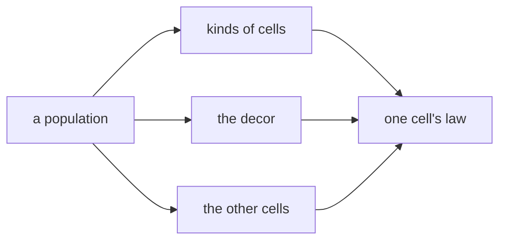
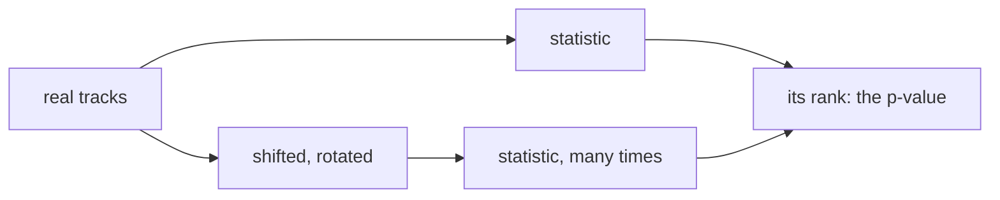

# Many trajectories

**[defined]** 2026-11-14. A video holds a population: cells of several kinds,
in a decor, perhaps acting on one another. One trajectory is a sample; the
questions worth asking are often about the set.

## What a population is

- **Kinds** $c_i$: a species, a strain, a phenotype (motile or not, alive or
  dead). Unknown in general: a mixture to infer.
- **The decor** $E$: static objects $O \subset \mathbb{R}^2$ (host cells,
  beads, walls, debris), and fields over the plane (a flow $u(x)$, a chemical
  gradient, light).
- **The others**: each cell's law may depend on the positions and axes of
  its neighbours.
- **Arrivals and departures**: cells enter and leave the field, and the
  focus; a track's start and end are rarely a birth and a death.

## The independence hypothesis

The simplest population: cells move independently, each by the law of its
kind, in a decor that does not touch them.

$$s_i \;\perp\; s_j \quad \text{and} \quad s_i \perp E \quad \text{given } c_i$$

Every population question is a departure from it:

| Departure | Question | Example |
| --- | --- | --- |
| Heterogeneity | does one law fit every cell of a kind? | diffusion coefficients spread wider than noise allows |
| Mixture | how many kinds, in what shares? | motile and non-motile, by their speeds |
| The decor | does the law change near objects? | trapped, slowed, steered along an edge |
| The others | does a cell react to its neighbours? | alignment, avoidance, chasing |

## Surrogates: the null of an interaction

Testing an interaction needs a population that is identical in every
respect but the interaction. Surrogates build it from the data:

- **shift each track in time**, or rotate it about its centre: every cell
  keeps its own law, its speed, its turns, but no longer meets its true
  neighbours at the true moment;
- **move a track across the decor**: the cell keeps its law, but no longer
  sits where it sat relative to the objects.

The statistic (an alignment, a distance to the objects) is computed on the
real population and on a few hundred surrogates; its rank among them is the
p-value. No distribution has to be assumed.

Back: [one trajectory](trajectory.md). Next: [the models](models.md).
