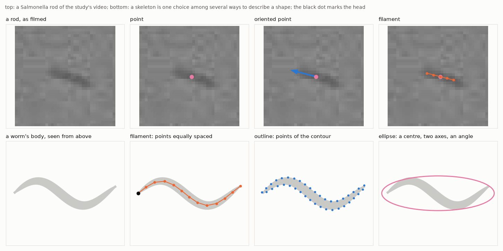

# Representing a shape

**[defined]** 2026-11-14. A cell is a body in three dimensions; the
microscope shows a two-dimensional view of it; the pipeline keeps a few
numbers of that view. Each step loses something, on purpose.

## From a body to a view

- **The view is a projection.** A rod tilted out of the focal plane looks
  shorter, a helix looks like a wave, a cell above the focus is a blur.
- **The representation is a choice.** It keeps what the questions need and
  drops the rest; a richer one costs more pixels per cell and more noise.

## Point and oriented point

- A **point** keeps the centre of mass: enough for speeds, MSD, most of the
  [one-cell hypotheses](hypotheses/one-cell/README.md).
- An **oriented point** adds the long axis of the shape, from the second
  moments of its pixels. On a rod of a few pixels the axis is noisy, and it
  has no head: the head is the end that leads, read from the motion.
- **[fact]** 2026-11-14: every detection carries its axis and its elongation,
  the long axis over the short one; `detection.min_elongation` drops what is
  too round to be a rod. On the study's video, 1.4 removed diffuse patches
  taken for still cells. The axis is not yet kept along a track.

## Skeletons

A skeleton is a small set of points that stands for a shape. There are
several, each fitted to a kind of body:

| Skeleton | It keeps | Fitted to |
| --- | --- | --- |
| [Filament](#the-filament-our-choice) | a chain of points along the body's midline | rods, filaments, worms |
| Outline | points along the contour | amoebae, cells that change shape |
| Ellipse | a centre, two axes, an angle | round or oval cells |
| Medial graph | a midline that may branch | hyphae, branching filaments |

## The filament, our choice

The cells of interest here are elongated: bacteria are rods, nematodes and
spirochaetes are filaments. A **filament** is $N$ points $p_1 \dots p_N$ along
the midline, equally spaced:

$$\lvert p_{i+1} - p_i \rvert = \ell = \frac{L}{N - 1}$$

- Its state is the centre and the $N - 1$ tangent angles, or the curvature
  $\kappa(s)$ along the body; a rod is the filament with $N = 2$.
- It carries the [gait](hypotheses/one-cell/gait.md): a wave travelling along
  the body is a change of its tangent angles in time.
- **[question]** The skeleton is not measured yet: `just skeleton` is a planned
  recipe; the axis along a track is `just axis`.

Back: [one trajectory](trajectory.md). Next: [the models](models.md).
