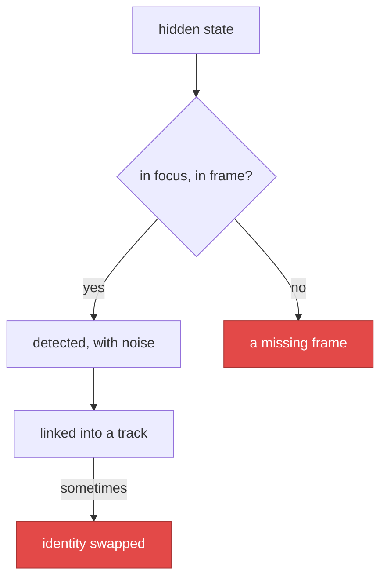

# One trajectory

**[defined]** 2026-11-14. What a cell is, mathematically, before any video:
a hidden state that moves in continuous time. Everything the pipeline
measures is an estimate of it.

## The state of a cell

Three levels of detail, each containing the one before.

| Level | State at time $t$ | Space | For |
| --- | --- | --- | --- |
| Point | position $x(t)$ | $\mathbb{R}^2$ | any cell, the coarsest view |
| Oriented point | $x(t)$ and body axis $\theta(t)$ | $\mathbb{R}^2 \times S^1$ | rods, swimmers |
| Skeleton | $N$ points $p_1 \dots p_N$, $\lvert p_{i+1} - p_i \rvert = \ell$ | $(\mathbb{R}^2)^N$ under $N-1$ constraints | worms, filaments, long bacteria |

- **The axis is not the velocity.** $\theta$ is where the body points; the
  velocity $\dot x$ may point elsewhere: a tumbling cell, a rod pushed by
  Brownian kicks, a swimmer drifting in a flow. Telling them apart is a
  hypothesis in itself.
- **A rod's axis has no head** ($\theta$ modulo $\pi$) until motion breaks
  the symmetry: the head is the end that leads.
- **A skeleton is a curve**: equivalently its centre and the tangent angles
  $\psi_1 \dots \psi_{N-1}$, or its curvature $\kappa(s, t)$ along the body,
  $s \in [0, L]$. A rigid rod is the skeleton with $N = 2$.

Hidden as well, never in a single frame:

- **the motor's state** $m(t)$: run, tumble, pause, reverse, a Markov jump
  process;
- **the depth** $z(t)$: it decides whether the cell is in focus, and the
  video does not show it.

## What the video shows

The video samples the state every $\Delta t$, and through an imperfect chain.

$$
y_k = x(t_k) + \varepsilon_k,
\qquad
\varepsilon_k \sim \mathcal{N}(0, \sigma^2 I),
\qquad
t_k = k\,\Delta t
$$

observed only when $v_k = 1$: in focus ($\lvert z \rvert < d$), in the frame,
above the detection threshold, outside the mask.

## Why it matters

Each link of the chain fakes a behaviour, and the tests must expect it:

| Link | What it fakes |
| --- | --- |
| Localisation noise $\sigma$ | an MSD offset $4\sigma^2$: Brownian cells look subdiffusive |
| Sampling $\Delta t$ | a tumble shorter than $\Delta t$ is a turn, not a pause |
| Leaving the focus | short tracks: too few steps to reject any null |
| An identity swap | a jump, a fake tumble, a fake fast cell |
| A missed detection | a gap the tracker bridges in a straight line |

So every test is validated on synthetic cells **seen through the same
chain**: noise, gaps and swaps included, never on perfect paths
([hypotheses](hypotheses/README.md)).

Next: [many cells](population.md).
